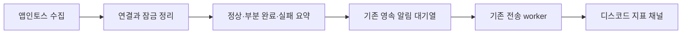

# 앱인토스 수집 직후 디스코드 알림 v1

- 요청 근거: 2026-10-14 사용자 “앱인토스도 수집되는거야 그럼? 수집 직후 디스코드 메시지도 보내”.
- 범위: 이미 승인·활성화된 앱인토스 수집의 종료 결과를 기존 디스코드 목적지 `metrics-daily`로 보낸다.
- 기존 수집·인증·저장 계약, 자격증명, 채널 설정, DB 스키마는 유지한다. 제품 화면은 변경하지 않는다.

결과 한 건에는 수집 날짜, 리스팅 수, 반영 건수, 결측·오류·보류 수와 리스팅별 최신 날짜를 담는다.
결측은 0으로 보정하지 않으며 실패 이전 저장 수가 불명확하면 확인 필요로 쓴다. 원본 응답·인증값·오류 본문은 제외한다.
실행 UUID를 중복 방지 키로 사용한다. 알림 대기열 등록은 디스코드 도착과 구분한다.
인증 점검·동시 실행 보류에는 메시지를 만들지 않는다. 알림 등록 실패는 수집 결과를 유지하며 별도 실패 코드와 종료 코드 1로 드러낸다.

새 봇·직접 webhook·별도 재시도 루프 대신 기존 outbox와 notification worker를 사용한다.
전송 worker는 현재 운영 준비 상태를 다시 읽어 확인했다. 수집 파드에 봇 자격증명을 추가하지 않는다.

인수조건: 실제 CLI/HTTP의 성공·실패 종료 후 한 번 enqueue, 부분 완료의 결측 보존, 원본/비밀값 제외,
인증 점검/잠금 보류 무알림, 알림 등록 실패 구분, 실제 채널 전송·재조회.
검증은 실패 재현 후 최소 구현, 단위·CLI 회귀, 격리 MySQL 대기열/전송 경로와 제품 전체 E2E를 사용한다.
제품 UI 변경이 없어 새 UI 검수 회차를 만들지 않는다. 새 후보의 빌드·배포 전 중앙 검증은 유지한다.
동일한 수집기 CronJob의 불변 이미지만 검증 후 갱신한다. 문제 시 해당 스케줄을 멈추고 이전 이미지로 복원한다.
