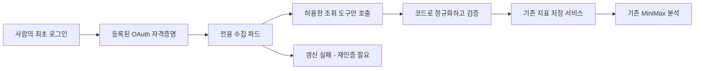

# 설계: 파드에서 AppsInToss 콘솔 지표 수집

- 설계 ID·버전: `2026-10-12-console-sync-pod`, v1
- 상태: v1 사람 승인, 구현·검증 진행
- 조사 기준: Backoffice `f7682393443e3a6d0436af7ad3d4dafb4b30341e`, 2026-10-12 KST
- 승인자·시각·근거: 사용자, 2026-10-12 KST(정확한 시각 미확인). “설계 v1 승인해. OAuth 갱신 검증부터 구현·검증·PR까지 진행해. 운영 배포와 스케줄 활성화는 별도로 승인할게.” 승인 커밋: `0b929ccb1d9a6272fb0d4004056791d31e5eb35c`.
- 관련 실행 티켓: [execution.md](execution.md). 검수: [검수 기록](../../qa/2026-10-12-console-sync-pod/report.md). Issue [#461](https://github.com/seorilabs/seorilabs-backoffice/issues/461). Ready PR은 실행 티켓에 연결한다.

## 목적·범위·근거

로컬 에이전트를 켜서 수집하던 일간 콘솔 지표를 백오피스 이미지의 전용 수집 파드에서 처리한다. OAuth 최초 로그인과 재인증은 사람의 대화형 동의를 유지한다.

2026-10-12 인증 없는 공개 조회에서 다음을 확인했다.

- MCP 주소는 `401`과 공개 인증 메타데이터 위치를 반환한다.
- [인증 서버 메타데이터](https://mcp.toss.im/.well-known/oauth-authorization-server)는 `authorization_code`와 `refresh_token`, PKCE `S256`을 광고한다. `client_credentials`는 광고하지 않는다.
- [공식 콘솔 가이드](https://developers-apps-in-toss.toss.im/guide/console-mcp.md)는 HTTP MCP 주소와 정적 client ID `mcp-gateway` 및 로그인 절차를 안내한다.
- 기존 런북은 과거 CLI에서 새 프로세스가 인증을 상속하지 못한 결과를 서버 수집 불가로 일반화했다. 공개 메타데이터는 갱신 경로의 존재를 보여주지만, 실제 토큰 발급·수명·회전·재시작 후 갱신 성공은 증명하지 않는다.
- `ConsoleMetricsSource`는 선언만 있고 구현이 없다. 저장 서비스와 MiniMax 분석 경로는 이미 있다.
- `ingestConsoleMetrics`는 광고·결제 필드를 생략해도 0으로 바꿔 전체 행을 갱신한다. 현재 런북의 결측 보존 규칙과 충돌하므로 자동화 전에 고친다.

포함: 조회 전용 MCP 클라이언트, 감독하의 OAuth 수명 검증, 수집기·매핑·검증, K8s 실행 정의, 누락값 보호, 런북 갱신. 제외: 출시·심사·푸시 등 콘솔 변경 도구, 신규 서비스 계정, 운영 배포·스케줄 활성화, 제품 UI, 지표 스키마 변경, 새로운 MiniMax 실행 경로.

## 사용자 흐름·상태

실행 상태는 대기, 실행 중, 완료, 부분 완료, 재인증 필요, 실패로 구분한다. 수집 종료 후 리스팅별 날짜와 저장 결과를 다시 읽어 확인한다. 날짜가 최신이어도 실패 지표가 남으면 완료로 표시하지 않는다. UI를 추가하지 않고 실행 결과와 기존 운영 상태 경로를 사용한다.

## 구조·책임·의존성

- 기존 웹 파드와 같은 이미지를 쓰는 별도 수집 Job/CronJob을 준비한다. 웹 요청 수명에 장시간 수집을 묶지 않는다.
- `ConsoleMetricsSource`의 HTTP MCP 구현이 읽기 도구를 명시적으로 호출한다. MiniMax에 도구 선택·토큰·수치 매핑을 맡기지 않는다.
- 허용 도구: 인증 확인용 `workspace_overview`, `dashboard_dau`, `dashboard_session`, `dashboard_revenue_iaa`, `dashboard_revenue_iap`. 리텐션은 별도 요청 범위로 유지한다.
- 수집 대상은 현재 `AIT_LISTINGS`와 상태 조회의 활성 리스팅 계약을 재사용한다. App·리스팅을 합치지 않는다.
- 저장은 `ingestConsoleMetrics`를 호출한다. 중앙 설정의 직접 DB 변경이나 별도 ingest 구현을 만들지 않는다.
- MiniMax는 이미 저장된 값의 기존 분석·요약 경로를 재사용한다. 수집에는 모델 호출이 필요 없다.

## 데이터·인터페이스·실패 처리

- 대상: `slug + workspaceId + miniAppId`. 날짜는 KST 어제까지, 2일 overlap, 리스팅당 최대 120일.
- OS별 광고 원본은 보존한다. 한 OS의 호출이 실패하면 양 OS 합계를 확정하지 않는다.
- 성공 응답에서 DAU 날짜가 없는 경우에만 null로 해석한다. 호출 실패·비정상 응답과 구분한다.
- 현재 non-null 광고·결제 필드를 확인할 수 없는 날짜는 전체 행 저장을 보류한다. 기존 값을 0이나 null로 덮어쓰지 않는다. 실패·결측은 기존 관측 원장과 실행 결과에 기록한다. 새로운 nullable 지표 스키마는 별도 설계로 다룬다.
- ingest에도 동일한 필수값 검증을 적용해 기존 push 경로의 생략값→0 변환을 막는다. 기존 로컬 producer가 불완전한 행을 보내면 skip/error가 늘 수 있으며, 이 계약 변화를 런북에 명시한다.
- 실제 0으로 응답한 값은 저장할 수 있다. 빈 배열만으로 광고·결제를 0으로 확정하지 않는다.
- 멱등 저장과 조회 재시도는 리스팅별로 처리한다. CronJob 동시 실행을 금지하고, 토큰 갱신도 단일 작성자로 직렬화한다.
- 인증 만료 시 지원된 갱신만 수행한다. `invalid_grant`, 권한 상실, 재로그인 요구 시 해당 연결을 멈추고 재인증 필요로 기록한다. 무한 로그인 재시도·OAuth 우회는 하지 않는다.

## 품질 요구사항·인증 확인 조건

수집 병렬도는 2로 제한하고, 요청 timeout·bounded retry·실행 deadline을 둔다. 공급자 429는 Retry-After를 따른다. 토큰·인증 코드·쿠키를 로그·원본 지표·DB·MiniMax 입력에 넣지 않는다.

OAuth를 새로 사용하기 전 `seorilabs-credentials`와 로컬 catalog에서 동일 identity·scope를 확인한다. 로컬 토큰 파일을 임의로 복사하지 않는다. 최초 인가용 클라이언트의 redirect 허용 범위, 실제 refresh 발급, 만료·회전·폐기 동작을 감독하에 검증한다.

현재 정책대로 로컬 credential 정본과 K8s 실행 복제본을 유지한다. 비회전 refresh라면 등록된 자격증명을 재사용한다. refresh rotation이 발생하면 기존 credential 관리 경로로 원본·실행 복제본을 일관되게 보존할 수 있어야 한다. 이 조건을 충족하지 못하면 인증 저장 구조를 임의로 추가하지 않고 후속 설계 검토를 요청한다. 이 확인 없이 스케줄 활성화를 승인하지 않는다.

## 대안·주요 결정

| 방법 | 판단 |
| --- | --- |
| 전용 파드의 코드 기반 MCP 수집 | 권장. 고정 지표·날짜 매핑을 재현할 수 있으며 모델 장애·비용과 수집을 분리한다. |
| MiniMax가 매번 도구를 선택하고 수치를 생성 | 수집에는 채택하지 않는다. 인증 문제를 해결하지 못하고 불필요한 변동을 늘린다. 분석에는 기존 경로를 재사용한다. |
| 기존 로컬 대화형 수집 | 인증 수명 검증이 실패하면 계속 사용한다. 일시적 우회 구현을 추가하지 않는다. |
| 서버 간 전용 Reporting API | 공개 메타데이터에서 확인되지 않았다. 있다고 가정하지 않는다. |

## 인수조건·테스트·검수

| 조건 | 통과 기준 | 검증 |
| --- | --- | --- |
| AC-1 | 최초 동의 후 지표 조회, 만료 후 갱신, 파드 재시작 후 조회가 성공한다. | 감독하의 실제 OAuth 검증. 미실행은 차단으로 기록한다. |
| AC-2 | revoke·invalid_grant에서 중단하고 재인증 필요를 기록한다. | 실제 허용 범위와 격리 provider 시험. |
| AC-3 | 불완전한 광고·결제 응답이 기존 수치를 변경하지 않는다. | 먼저 실패하는 ingest 회귀 테스트, 새 행 생성 보류·기존 행 보존. |
| AC-4 | 다중 리스팅·KST 날짜·overlap·120일 구간·OS 원본이 정확하다. | 응답 fixture 기반 mapper와 날짜 테스트. |
| AC-5 | 중복 실행·429·일부 지표 실패·빈 결과를 구분하며 오류 범위만 재시도한다. | 수집기 service-runtime 통합 검증. |
| AC-6 | 모든 리스팅의 저장 결과·실패·마지막 날짜를 다시 읽어 확인한다. | 격리 DB와 실제 공급자 readback을 별도 기록. |
| AC-7 | 토큰이 지표·로그·모델 입력에 없으며 쓰기 도구 호출이 없다. | allowlist·redaction 검사와 credential identity 확인. |

매핑·결측·재시도는 테스트 우선으로 구현한다. 실제 OAuth 상호작용은 fixture만으로 통과를 주장할 수 없어 별도 실측이 필요하다. 제품 UI 변경이 없어 UI 3회 검수는 해당하지 않는다. 빌드 전 service-runtime E2E와 중앙 근거 검증기를 사용하며, 실제 provider 검증·배포 후 수집 증거와 구분한다. PR 전 typecheck·lint·build를 실행한다.

## 적용·운영·되돌리기

1. 승인 후 실행 티켓과 감독하의 OAuth 수명 검증부터 진행한다. 토큰 회전·redirect 저장 조건이 다르면 설계를 다시 검토한다.
2. ingest 결측 보호, MCP 클라이언트, 수집 worker와 비활성 K8s 실행 정의를 구현·검증한다.
3. 현재 console-sync의 “대화형 세션에서만 실행한다” 규칙은 이 조회 전용 경로에 한해 개정한다. 최초 동의·재인증·만료 우회 금지와 나머지 안전 규칙은 유지한다. 실제 운영 인증 gate를 확인하기 전 기존 규칙을 우회하지 않는다.
4. 코드·Ready PR과 실제 조회 검증 결과를 검토한 뒤, 별도 운영 배포·스케줄 활성화 승인을 받는다. 권장 첫 스케줄은 21:30 KST 일 1회이며 운영 승인 시 고정한다.
5. 첫 자연 실행의 리스팅별 readback, 인증 상태, 실패·결측·저장 수를 확인한다. 수집 성공만으로 MiniMax 보고서 전송 성공을 주장하지 않는다.
6. 문제 발생 시 CronJob을 suspend하고 기존 대화형 수집으로 운영한다. 기존 지표를 지우거나 0으로 보정하지 않는다.

## 승인·추적

승인 대상은 v1의 OAuth 검증·결측 보호·조회 전용 수집 구현·비활성 K8s 정의·한정된 스킬/런북 개정이다. 실제 운영 배포·자격증명 회전·정본 변경·스케줄 활성화는 포함하지 않는다. 사람 승인 근거와 설계 커밋, 티켓·PR·QA를 같은 ID로 연결한다.
