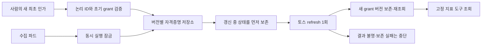

# 설계 v2 제안: 회전하는 콘솔 OAuth의 보존

- 설계 ID: `2026-10-12-console-sync-pod`, v2 **사람 승인 대기**. 구현·자격증명 이관은 하지 않았다.
- 근거: 2026-10-13 KST 새 최초 인가·실제 조회·로컬 등록 뒤 첫 실제 refresh에서 `OAUTH_ROTATION_REQUIRES_REVIEW`를 확인했다. 응답의 새 refresh 값이 기존 값과 다르다. 옛 값의 계속 사용 가능 여부·폐기 시점은 확인하지 않았으며 다시 전송하지 않는다.
- 기존 승인 범위: [v1](design.md), [보완 설계](review-followup.md). 회전 시 중단하고 보존 설계를 다시 검토하도록 승인받았다. 운영 배포·스케줄은 계속 별도 승인이다.

## 문제와 현재 상태

현재 worker는 받은 access token을 프로세스에만 보존하고 읽기 전용 파일의 refresh token을 재사용한다. 비회전인 경우만 이 구조가 가능하다. 새 refresh를 버리는 현재 중단 동작을 성공으로 바꾸는 것만으로 재시작·다음 Job의 인증을 보장할 수 없다.

최초 grant는 `shared/apps-in-toss/console-oauth`로 로컬 카탈로그에 등록했고 원본 파일·암호화 백업을 보존했다. 실제 회전 확인 뒤 상태를 `unresolved`로 기록했다. 회전 응답의 새 grant는 승인된 설계대로 보존·사용하지 않았으므로 다음 실측은 새 최초 인가부터 시작한다. 과거 파일의 복원으로 이미 소비된 provider grant를 되살릴 수 있다고 가정하지 않는다.

## 권장 구조와 승인할 정책 예외

이 OAuth에 한해 서버에서 버전별로 보존할 수 있는 GCP Secret Manager를 운영 정본으로 제안한다. 로컬 카탈로그는 같은 논리 ID·공개 identity·generation·복구 참조를 보관하며, 로컬 파일은 초기 인가와 암호화 복구 사본 역할로 전환한다. 로컬 파일과 서버 사본을 동시에 활성 정본으로 사용하지 않는다.

이는 `~/.config/seorilabs`가 원본이고 Kubernetes Secret은 실행 복제본이라는 현행 정책의 **이 논리 ID만을 위한 명시적 예외 승인**이 필요하다. 다른 자격증명 정책은 바꾸지 않는다. 운영 정본 전환은 운영 승인 시점에만 적용한다.

Secret Manager는 [불변 secret 버전 추가](https://docs.cloud.google.com/secret-manager/docs/add-secret-version)와 [버전 ID로 읽기](https://docs.cloud.google.com/secret-manager/docs/access-secret-version)를 지원한다. 이 기능을 사용한 보존 방식은 제안이며 현재 운영 권한·리소스가 확인되거나 만들어진 상태는 아니다.

기존 Backoffice에는 `google-auth-library`가 있지만 Platform Admin 호출 identity는 해당 호출 전용이다. 기존 seori-auth runtime은 기본 replicas=0이며 다른 purpose의 vault key나 retired Secret Manager 사본을 이 OAuth에 재사용하지 않는다. 기존 등록 identity가 새 purpose·권한에 맞는지 확인한 뒤 재사용하고, 없으면 필요한 최소 권한의 WIF 연결을 운영 승인 항목으로 제시한다. 새 정적 서비스 계정 키는 만들지 않는다.

## 저장·갱신 계약

1. DB의 기존 수집 잠금을 먼저 획득한 뒤 공개 runtime 상태의 `generation`, `phase`, **정확한 Secret Manager 버전 ID**를 읽는다. 지금의 잠금 전 파일 읽기를 잠금 안으로 이동한다. `latest`/alias를 실행 포인터나 복구 fallback으로 사용하지 않는다. 공식 [권장 방식](https://docs.cloud.google.com/secret-manager/docs/best-practices)에 따라 정확한 버전으로 읽는다.
2. token 원본은 Secret Manager payload에만 보존한다. 공개 runtime 상태는 새 `ConsoleOAuthRuntimeState` 모델로 logical ID, generation, phase, secretVersion, 시각만 기록한다. `src/lib/control-plane/`의 validator·범위 권한·optimistic concurrency·idempotency·append-only audit를 가진 서비스가 이 상태를 변경한다. `ConfigRevision`이나 기존 credential catalog provenance를 갱신마다 임의 수정하지 않는다. 이 모델의 schema/migration은 v2 구현 범위에 명시적으로 포함하며 운영 적용은 별도다.
3. provider refresh 전에 runtime 상태를 비교 후 변경(CAS)해 `REFRESH_IN_FLIGHT`로 보존·재조회한다. 그 다음 정확한 버전의 grant를 읽는다. 잠금·상태 보존이 실패하면 provider를 호출하지 않는다. 이 상태를 읽는 새 실행은 옛 refresh를 사용하지 않고 중단한다.
4. provider refresh는 재전송 없이 1회다. 정상 응답은 새 refresh 유무와 전체 필드를 검증한 뒤 Secret Manager에 새 불변 버전으로 보존하고 **응답에 받은 버전 ID**로 재조회한다. 이어 runtime 상태를 같은 generation의 IN_FLIGHT에서 ACTIVE·새 버전·generation+1로 CAS하고 재조회한 뒤에만 MCP를 계속 호출한다. 비회전 응답도 같은 상태 절차를 따른다.
5. 응답 불명·취소·불완전 응답·보존 불명은 IN_FLIGHT를 옛 ACTIVE로 되돌리지 않는다. DB 잠금을 잃거나 generation이 달라지면 provider를 더 호출하지 않는다. Secret 보존은 됐지만 runtime 상태의 CAS가 실패하면 해당 버전은 복구 검토 대상으로 남기며 `latest`로 자동 연결하지 않는다.
6. provider 발급과 저장소 쓰기를 하나의 원자적 거래로 묶을 수 없다. provider 발급 직후 프로세스가 죽으면 새 grant를 잃을 수 있으며 사람의 재인가가 필요하다. 이 구간을 자동 성공·재시도·옛 버전 복원으로 처리하지 않는다. 정상 보존 뒤 응답만 유실된 경우에도 정확한 runtime generation과 버전 ID 재조회 없이는 성공으로 표시하지 않는다.
7. DB 복원·재인증 시에는 실행을 중지하고 provider와 저장소·공개 runtime generation을 확인한다. 예전 generation이나 IN_FLIGHT를 옛 토큰으로 활성화하는 복원은 금지한다. 소비된 refresh를 백업 복원만으로 되살릴 수 없다.
8. 초기 등록과 계획된 복구 변경 전에는 기존 전체 백업·로컬/BeeStation 복원 gate를 유지한다. 정상 자동 갱신은 해당 OAuth의 암호화된 불변 버전 추가·재조회와 runtime 상태 CAS로 보존하도록 별도 정책 예외를 승인받는다. Backoffice DB·로그·지표·모델에는 공개 ID·generation·fingerprint·안전 오류 코드만 남긴다.

## 실행 환경과 권한

- 운영 worker의 Secret Manager 권한은 지정된 secret 하나의 접근·버전 추가만 허용한다. 프로젝트 전체 secret 관리·버전 삭제 권한은 주지 않는다.
- Kubernetes Secret에 매번 최신 OAuth를 역기록하지 않는다. worker는 고정 논리 ID와 등록된 runtime identity로 저장소를 읽는다. 수집 도구 5개·주소·지표 정책·MiniMax 경로는 유지한다.
- 버전 보존 비용·보관 기간·현재 version의 삭제 방지와 운영 백업은 운영 승인 문서에 고정한다. 구현 단계에서 임의로 오래된 버전을 삭제하지 않는다.
- 로컬 실제 OAuth 검증은 같은 상태 계약의 보호된 로컬 저장소를 사용하고 새 grant를 로컬 정본에 보존한다. 격리 Kubernetes의 재시작 검증에서만 승인된 새 grant의 비공개 실행 복제본을 사용한다. 이 시험을 운영 Secret Manager/IAM 성공으로 표시하지 않는다.
- 운영 프로젝트·secret 이름·IAM identity는 미확정이다. 등록 identity의 목적과 live 권한을 확인하지 않고 기존 identity를 승격하거나 대체하지 않는다.

## 구현·검증 범위

이 v2 승인 시: 버전 보존 인터페이스와 Secret Manager 구현, 공개 runtime 상태 모델·안전 migration·서비스, 상태·generation 검증, 잠금 순서 수정, 정책/카탈로그의 해당 논리 ID 예외 문서, 새 최초 인가·보존을 포함한 실측과 PR 갱신을 수행한다. 새 운영 클라우드 리소스·IAM 적용·Kubernetes Secret·배포·스케줄 활성화는 별도 승인으로 남긴다.

- TDD: 회전 응답 정상 보존, 비회전, 보존 실패 전 provider 호출 0회, 전송 후 불명 중단, 새 실행의 IN_FLIGHT 차단, 중복 실행, 오래된 generation, 비밀값 로그/DB 유출 차단.
- 실제 OAuth: 새 최초 인가 → 강제 갱신·새 refresh 보존과 지표 조회 → 자연 만료 후 갱신 → 실제 격리 파드/새 Job에서 최신 generation 재사용. 만료 시각을 바꾸지 않는다.
- 저장소 장애: provider 응답 뒤 쓰기/재조회 장애·프로세스 종료를 주입하고 옛 grant 재전송이 없는 것을 확인한다. 실제 revoke는 허용 범위를 따로 확인한다.
- 격리 DB 14개 리스팅·전체 회귀·typecheck·lint·중앙 검증을 반복하고 실제 미실행/차단은 유지한다. 추가 모델 리뷰는 이미 사용한 2회 상한을 넘기지 않는다.
- 운영 전: 실제 Secret Manager identity/권한·버전 쓰기/재조회·복구와 Backoffice 전체 제품 E2E를 별도 통과해야 한다.

## 승인 선택

권장: **v2 설계와 위 논리 ID의 정책 예외를 승인하고 구현·새 인가·실제 갱신·재시작 검증까지 진행. 운영 리소스 적용·배포·스케줄은 별도 승인 유지.**

대안: 현재 중단 결과만 유지하고 자동 파드 수집을 보류한다. 유효한 별도 승인 없이 옛 grant나 기존 프로그램 캐시로 계속하지 않는다.
