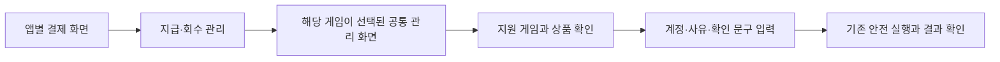

# 설계: IAP 관리 경로와 앱 카드 정리

- 설계 ID·버전: `BO-IAP-CARDS-20261012-v1`
- 상태: 사람 승인 · 구현 및 검증 중
- 조사 기준: Backoffice `f7682393443e3a6d0436af7ad3d4dafb4b30341e`, 중앙 계약 `458096f05165494054e8be0039437454440f65b8`
- 승인자·시각·근거·승인 커밋: syous, 2026-10-12 KST, v1 제안 뒤 사용자 “진행”. 승인 커밋 `ed118bccea28b590d4b20d05a47fe76e1480c3de`의 아래 범위다.
- 관련 Issue·PR·검수: [실행 티켓 #457](https://github.com/seorilabs/seorilabs-backoffice/issues/457). Ready PR과 검수 결과는 완료 후 연결한다.

## 목적·범위·근거

앱별 결제 화면에서 실행을 거부하는 지급 버튼을 없애고, 실제 지급이 가능한 게임만 공통 관리 화면에서 선택하게 한다. 사용자가 지정한 불필요한 앱 카드 두 개를 숨기며, 운영 중지의 의미를 분명하게 한다.

| 항목 | 현재 관찰 | 변경 후 |
| --- | --- | --- |
| 앱별 지급·회수·Sandbox 초기화 | 플랫폼 쓰기가 켜진 운영 환경에서 기존 버튼이 요청을 만든 뒤 `/platform/iap`를 사용하라는 오류를 반환 | 실행 불가능한 입력·버튼 대신 해당 게임이 선택된 공통 관리 화면으로 연결 |
| 공통 관리의 게임 선택 | 권한 있는 모든 ACTIVE 앱을 넣음. IAP 없는 게임과 비게임 앱도 포함 | ACTIVE·GAME·현재 운영자 권한·플랫폼의 정상 비어 있지 않은 IAP 카탈로그가 모두 확인된 게임만 표시 |
| 불필요한 앱 카드 | `animal-chess`, `minimax-defense`가 ACTIVE로 노출 | 두 항목의 Backoffice 운영 상태를 DEPRECATED로 전환하여 기존 공통 조회 조건으로 숨김 |
| 일시중지 표시 | 앱 운영 상태 PAUSED를 짧은 문구로만 설명 | 버튼·상태를 ‘자동 운영 중지’/‘자동 운영 재개’로 표시하고 적용 범위를 짧게 안내 |

운영 읽기 확인(2026-10-12): 웹과 AppOps worker의 `FEATURE_PLATFORM_ADMIN`·`FEATURE_PLATFORM_ADMIN_WRITES`는 true이며 worker는 실행 중이다. 도마뱀 테라리움의 공통 지급 요청은 13건 SUCCEEDED로 기록됐고, 최신 건은 2026-10-12 19:23:11 KST 완료·플랫폼 응답 `applied: true`다. 이는 기존 서버 처리 이력이며 실제 기기에서 보상이 표시됐다는 증거는 아니다. 조사 중 지급·회수·초기화를 실행하지 않았다.

카드 제거 대상은 운영 DB에서 이름·slug·저장소를 함께 확인했다.

| 화면 이름 | 정확한 대상 | 기존 상태 |
| --- | --- | --- |
| 픽셀 동물전장 (Critter Tactics) | `seorilabs/animal-chess` | ACTIVE |
| 결정론적 일일 타워 디펜스 게임 | `seorilabs/minimax-defense` | ACTIVE |

게임 자체·스토어 리스팅·GitHub 저장소를 삭제하지 않는다. 기존 중앙 설정 버전, 이슈·PR·출시·감사 이력은 보존한다. 상품 카탈로그 등록 여부와 실제 기기 구매·지급 검증은 별개로 기록한다.

## 사용자 흐름·화면 상태

- 예시: 도마뱀 테라리움 → **지급·회수 관리** → 게임 **도마뱀 테라리움** / 작업 **지급** / 상품 **선택**.
- URL에는 게임 ID만 넣는다. 계정·상품·사유·확인 문구를 URL에 넣지 않는다.
- 잘못된·지원하지 않는 게임 링크는 안내를 표시하고 지급을 막는다. 다른 게임으로 조용히 바꾸지 않는다.
- 카탈로그 확인 중에는 변경을 막는다. 미지원·빈 카탈로그·조회 실패를 구분하며, 확인에 실패한 게임을 선택 가능 상태로 넣지 않는다. 연결 장애를 ‘지원 게임 없음’으로 단정하지 않는다.
- 지원 게임이 없거나 쓰기가 비활성인 경우 실행 입력 대신 짧은 상태 안내를 보여 준다. 기존 원장 조회는 유지한다.
- 게임·작업 변경 시 새 지급 입력과 확인 문구를 초기화한다. 결과 미확인 요청은 기존 request ID·게임·작업에 고정해 복구하며 새 요청으로 바꾸지 않는다.
- 작은 화면·큰 글자에서도 상태와 연결 버튼을 읽고 사용할 수 있게 한다. 키보드 탐색·명시적 라벨·오류 알림을 유지한다.
- ‘자동 운영 중지’ 안내: **백오피스의 자동 작업과 해당 수집 대상에서 제외됩니다. 스토어 판매나 게임 서버는 중단하지 않습니다.** 기존 PAUSED 동작을 바꾸지 않는다. 중지된 게임은 공통 IAP 변경 대상에서도 제외되는 기존 조건을 유지한다.

## 구조·책임·의존성

1. 앱별 `operations/commerce/page.tsx`와 `LizardTycoonIapConsole`은 실제 활성 실행 경계에 따라 공통 관리 연결을 표시한다. 기존 앱별 조회·필요한 legacy 실행 경로는 정리 승인 조건을 충족하기 전 보존한다.
2. 공통 `platform/iap/page.tsx`는 기존 앱 범위 권한 조회 후 `PlatformClient.catalogEntitlements`의 공식 읽기 응답으로 지원 게임을 결정한다. 추가 정적 게임 목록이나 설정 정본을 만들지 않는다. 조회는 제한된 병렬 수와 기존 시간 제한을 사용한다.
3. `PlatformIapManagement`는 유효한 게임 링크와 서버에서 확인한 선택 목록을 받는다. 기존 확인 문구·동일 ID 복구·앱별 변경 잠금·worker 재검증을 재사용한다.
4. 두 카드 숨김은 `src/lib/control-plane/`의 앱 운영 상태 서비스와 같은 서비스를 호출하는 API/운영 실행 경로로 처리한다. 현행 `setAppStatusCore`와 admin status API는 DEPRECATED를 허용하지 않으므로 SQL·직접 Prisma 수정으로 우회하지 않는다. 필요한 숨김 계약은 동일 validator·앱 범위 권한·동시 변경 검사·멱등 처리·감사 기록을 적용한다. 일반 화면에 새 삭제 기능을 넓히지 않는다.
5. 상태 문구는 기존 운영 상태 모델과 표시를 분리한다. PAUSED/DEPRECATED의 저장값과 개발·출시 단계는 바꾸지 않는다.

## 데이터·인터페이스·실패 처리

- 기존 `GET /v1/admin/apps/{appId}/iap/catalog`는 IAP 기능, 상품 allowlist·실제 카탈로그·원장 환경을 검사한다. 정상 응답의 앱 ID 일치와 상품 목록을 검증한다. 플랫폼 서버는 지급 직전에도 동일 조건을 재검증한다.
- 선택 가능한 게임 판정은 조회 응답이며 중앙 ConfigRevision을 덮어쓰지 않는다. 사람/AI 권한을 선택 목록으로 확대하지 않는다.
- 카드 숨김 요청은 정확한 앱·예상 갱신 시각·사유·요청 ID·검증된 운영자에 결합한다. 다른 대상/내용으로 같은 ID를 재사용하면 거부하고, 동시 변경이면 최신 상태를 다시 읽는다. 상태 변경과 append-only 감사는 한 트랜잭션으로 처리한다.
- 숨김 전에 해당 앱의 진행 중 실행을 확인한다. 진행 중 외부 변경이 있으면 임의 취소하지 않고 필요한 조치와 입력 gate를 기록한다.
- 상태는 재스캔으로 덮어쓰지 않는 기존 시드 동작을 유지한다. 설정 payload 수정, 스키마 이관, legacy 삭제는 이 범위에 없다.
- 비밀값·PUID·영수증을 조사 문서나 URL·브라우저 저장소에 추가하지 않는다.

## 품질·대안·결정

전체 IAP 기능 비활성화 대신 검증된 공통 경로를 유지한다. 앱별 새 지급 구현은 중복 원장과 복구 동작을 늘리므로 추가하지 않는다. 카드를 물리 삭제하거나 화면에 저장소 이름을 하드코딩해 제외하지 않고 기존 비활성 상태와 공통 조회를 사용한다.

‘일시중지’의 내부 동작 개선이나 완전한 운영 중단은 별도 범위다. 이번 변경은 의미 안내이며 판매·게임 서버 중지를 보장하지 않는다.

## 인수조건·테스트·검수

| 조건 | 통과 기준 | 검증 |
| --- | --- | --- |
| AC-1 | 플랫폼 쓰기가 켜지면 앱별 막힌 지급·회수·초기화 버튼이 없고 해당 게임의 공통 화면으로 이동 | 플래그 양쪽 회귀·개발 서버 브라우저 |
| AC-2 | IAP 없음·비게임·권한 없음·중지·빈 카탈로그·조회 실패 게임이 선택 목록에 없고 확인된 게임만 표시 | 요구사항 실패 테스트 후 순수 판정·서버 조회 테스트 |
| AC-3 | 잘못된 게임 링크·늦은 이전 카탈로그·게임 전환이 다른 게임 지급을 만들지 않음 | 기존 카탈로그·확인 문구·요청 복구 회귀 및 브라우저 |
| AC-4 | 두 지정 카드만 숨겨지고 이력·설정이 유지되며 재스캔 후 다시 나타나지 않음 | 격리 DB로 권한·멱등·동시 변경·감사·조회·시드 확인 |
| AC-5 | 자동 운영 중지 설명을 읽을 수 있고 ACTIVE↔PAUSED의 기존 적용 범위 유지 | 표시·상태 전이 회귀 및 브라우저 |

- 테스트 우선: 지원 게임 판정·숨김 서비스의 잘못된 대상/권한/동시 변경/멱등 조건. 단순 문구에는 구현을 복제하는 테스트를 추가하지 않고 실제 실행으로 검증한다.
- UI 독립 검수 3회: 1회 연결·선택·빈 상태, 2회 오류·키보드·작은 화면·큰 글자·취소, 3회 복구·원장 조회·기존 기능 회귀. 매번 계획과 증거를 먼저 고정하고 구현자와 다른 에이전트가 재현한다.
- 운영자·앱·원장 데이터는 격리한다. 실제 운영 사용자에게 검수 지급을 하지 않는다. 서버 원장 응답과 게임 내 보상 반영을 별도 조건으로 기록한다.
- `pnpm typecheck`, `pnpm lint`와 최종 기능 목록의 개발 E2E를 수행한다. 빌드 직전 중앙 검증기 통과 후 `pnpm build`를 수행한다. 미실행·차단을 성공으로 기록하지 않는다.

## 적용·운영·되돌리기·승인

설계 승인 → 실행 티켓 → 구현·격리 검수·Ready PR → CI·병합 순서다. 코드 배포는 별도 승인이다. 승인된 두 카드의 실제 숨김은 검증된 서비스 경로가 준비된 뒤 수행하고 재조회한다. 현재 운영 데이터는 아직 변경하지 않았다.

오류 시 공통 지급의 기존 서버 검증과 잠금을 유지하고 입력을 차단한다. 코드 복구는 이전 검증 버전으로 되돌리며, 운영 상태 복구도 권한·동시 변경 검사·감사 기록이 있는 서비스 경로를 사용한다. 기존 원장과 설정 이력을 삭제하지 않는다.

Wiki 게시 전까지 `docs/design/README.md`에 원본·승인·실행 링크를 기록한다. 승인된 설계 커밋, 티켓, PR, 검수 근거를 같은 설계 ID로 연결한다.

## 리뷰 후 승인 보완

2026-10-13 사용자 승인으로 [결과 확인 대기 실행의 숨김 차단 보완](review-recheck.md)을 같은 PR #458에서 수행한다. 원래 인수조건을 줄이지 않고 AgentRun 차단 조건 한 항목과 실제 DB 회귀 두 건을 추가한다.
