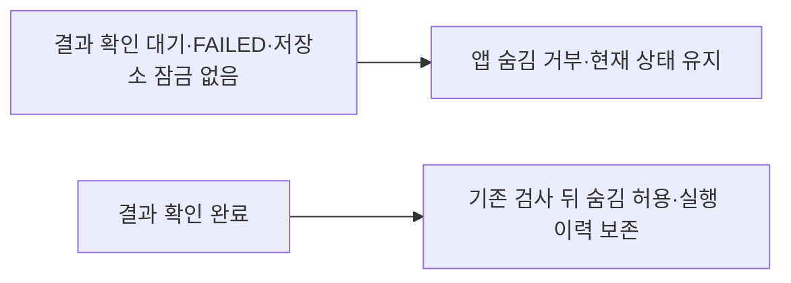

# 앱 숨김 결과 확인 대기 보호 보완

- 설계: `BO-IAP-CARDS-20261012-v1`의 AC-4 보완.
- 사람 승인: 2026-10-13 KST, syous. 사용자 “같은 PR에서 최소 수정하고 검증·빌드·CI까지 진행해.”
- 실행: [PR #458](https://github.com/seorilabs/seorilabs-backoffice/pull/458), [결함 이슈 #460](https://github.com/seorilabs/seorilabs-backoffice/issues/460).
- 기존 후보: `1a8fbebaf2a8f419c682bb4141adb1ecf7fb38c1`. 준비된 최소 patch SHA-256: `f719cfefa99b846e1eb50e836ae68052d5cc3f5e046df4896beece9655f01cd8`.

## 실패와 최소 변경

`outcome=unknown`인 실행은 외부 변경이 시작되지 않아도 FAILED와 `readbackRequestedAt` 값으로 저장된다. 외부 변경이 없으면 저장소 잠금은 해제되므로, 기존 숨김 검사가 PENDING/RUNNING과 활성 저장소 잠금만 확인하면 결과 확인 전에 숨김을 허용한다. 변경 전 격리 MySQL에서 미확인 실행 차단 테스트가 `Missing expected rejection`으로 실패했고 완료 실행 대조 테스트는 통과했다.

AgentRun의 숨김 차단 OR 조건에 `readbackRequestedAt != null` 한 항목만 추가한다. 실제 DB 회귀는 미확인 실행의 상태/감사 보존과 완료 실행의 숨김/이력 보존 두 건이다. ProviderExecution은 기존 READBACK_REQUIRED 차단을 유지한다. 상태 모델·스키마·UI·외부 실행 계약은 바꾸지 않는다.

## 검증과 실행 경계

요구사항 실패 → 최소 조건 추가 → 기존 실제 MySQL 8건과 새 2건의 통과를 확인한다. 새 후보 SHA에서 전체 42개 기능의 개발 E2E, 회귀, 권한·감사·큐·재스캔·쓰기 off 경계, typecheck/lint를 실행하고 중앙 before-build 검증 뒤 build와 CI까지 진행한다.

기존 독립 UI1~4의 당시 SHA·실패·해결·사람 승인 근거는 보존한다. 이번 서버 차단 조건은 화면과 사용자 흐름을 바꾸지 않으므로 UI5를 시작하지 않는다. 최종 E2E는 새 SHA에서 다시 실행한다. 추가 기능·UX 회차가 필요한 결함이 나오면 별도 범위 승인을 받는다.

Copilot 리뷰 두 번의 실제 깊이는 Lite다. 2회차 같은 영역 결함에 대해 이번 사람 승인으로 같은 PR 최소 보완을 선택했다. 리뷰를 다시 요청하지 않는다. 교차 리뷰 미실시의 병합 결정과 코드 배포 승인은 별도로 유지한다. 실제 사용자 지급·외부 공급자 변경을 검증에 사용하지 않는다.
