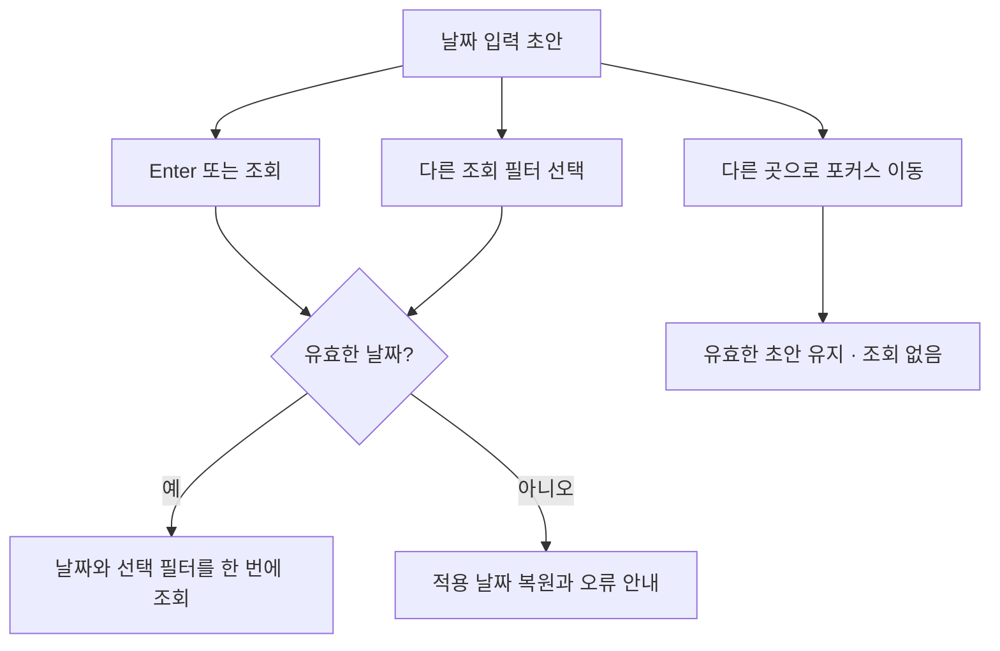

# 검색 순위 날짜 입력 설계 v1.1 — 승인됨

- 설계 ID: `BO-KEYWORD-WEB-20261012-v1.1-date-input`
- 상태: 사용자 승인. 2026-10-13의 명시적 “v1.1 수정안과 UI 검수 9회차 1회 승인해. 통과하면 기존 승인대로 PR 머지·배포까지 쭉 진행해.”에 근거한다.
- 승인 설계 커밋: `0fa39d91b152c82d8acf991c313c2c65ec9683e3`. UI 최대 회차는 9이며 코드 리뷰 요청은 2회로 종료한다.
- 상위 승인: `BO-KEYWORD-WEB-20261012-v1`. 기존 DB 연결·웹 조회·PR·머지·배포 승인은 유지한다.
- 검토 소스: `fca77e249e88d23a7dd5c72991a42e7c011ff31a`, PR [#463](https://github.com/seorilabs/seorilabs-backoffice/pull/463).

## 실제 확인한 문제

수정분 한정 코드 리뷰 2회차에서 나온 날짜 경계 두 건을 격리 브라우저에서 재현했다.

| 사용자 입력 | 실제 결과 | 기대 결과 |
| --- | --- | --- |
| 2026-10-14 입력 후 다른 곳 클릭 | 입력은 10-14, URL·표는 10-12, 안내 없음 | 미래 날짜 거절과 실제 적용 날짜 안내 |
| 2026-09-15 입력 직후 7일 클릭 | URL·표는 9-15·30일, 7일 클릭 누락 | 9-15·7일을 한 번에 적용 |

원인은 날짜 입력의 포커스 이탈이 먼저 서버 조회를 시작하면서, 뒤이어 누를 필터를 비활성화하는 동작이다. 수집 실패 설명의 `재시도` 표현도 동일 시도에서 관측 저장 뒤 실패한 경우를 포함하도록 정정한다.

## 확정 제안

1. 날짜는 입력 초안과 현재 적용값을 구분한다. 입력 도중에는 DB 조회를 시작하지 않는다.
2. 날짜 입력 옆에 `조회` 버튼을 둔다. `Enter` 또는 `조회`를 누르면 유효한 날짜를 한 번 반영한다.
3. 날짜 입력 후 앱·국가·7/30/90일·검색어 등 다른 조회 필터를 선택하면, 유효한 날짜 초안과 선택 필터를 하나의 요청으로 함께 반영한다. 전일·익일은 유효한 날짜 초안을 기준으로 이동하고 오늘은 현재 KST 날짜를 사용한다.
4. 유효한 날짜에서 포커스만 벗어나면 초안을 유지한다. 아직 적용 전임을 안내한다. 이탈 자체는 조회를 시작하지 않는다.
5. 미래·잘못된 날짜는 현재 적용값으로 복원하고 오류 이유를 표시한다. 빈 입력은 현재 적용값으로 복원한다. 복원 뒤 다른 필터를 선택해도 필터 클릭을 누락하지 않는다.
6. 설명은 `관측을 저장한 뒤 수집이 실패한 날은 저장된 관측과 시각을 함께 표시합니다.`로 쓴다. 동일 실패를 재시도로 추정하지 않는다.

이 변경은 DB·인증·수집·API 범위·의존성·배포 방식에 영향을 주지 않는다. 입력 및 조회 시점만 수정한다. 다른 필터 선택 시 유효한 날짜도 함께 적용해 사용자가 입력한 날짜를 잃지 않는다.

## 검증·추가 회차 제안

- 위 두 실제 실패와 단일 시도 실패 설명을 먼저 회귀 테스트로 확인한다.
- 직접 연도·일 입력, Enter·조회, 날짜 직후 기간·앱·국가·검색어 선택, 전일·익일·오늘, 미래·빈 날짜, 중복 요청 여부를 작성자가 검증한다.
- 독립 UI9 1회: 핵심 기능 11개 전체와 새 조회 버튼의 모바일·키보드·터치·200% 글자, 오류 복구를 확인한다. 예상 3~5분, 추가 유료 서비스 없음. 실패·차단이면 원본을 보존하고 추가 독립 회차를 자동 시작하지 않는다.
- 전체 43개 기능 E2E, 전체 계약·타입·린트·빌드·CI 및 중앙 검증은 새 정확한 커밋으로 실행한다.
- 코드 리뷰 요청은 두 번으로 종료하며 세 번째를 요청하지 않는다. 지적별 처리 답변과 사람의 설계 재검토 승인을 PR에 기록한다.
- 모두 통과하면 기존 승인대로 squash merge하고, 병합 커밋의 새 E2E·중앙 검증 후 운영 배포·실제 DB 읽기·readiness를 확인한다.

## 승인 필요 이유

[seori-pr-workflow](https://github.com/seorilabs/.github/blob/main/CONTRIBUTING.md)와 로컬 `seori-pr-workflow/SKILL.md`는 `2회차에도 같은 영역에서 실패 시나리오가 있는 결함이 나오면 리뷰를 더 돌리지 않는다. 설계 문제로 보고 PR 분할이나 설계 재검토를 사람에게 확인한다.`고 명시한다. 승인된 추가 UI8은 종료되었으므로 UI9도 사전 승인 대상이다. 이번 제안은 같은 기능의 날짜 확정 동작만 재검토한다.
