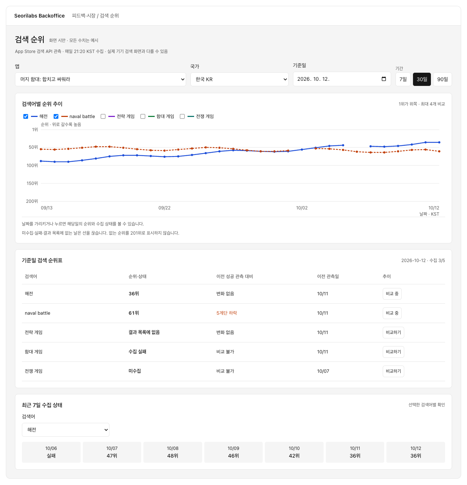
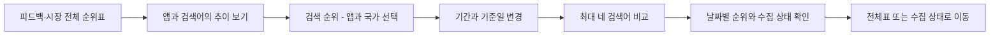
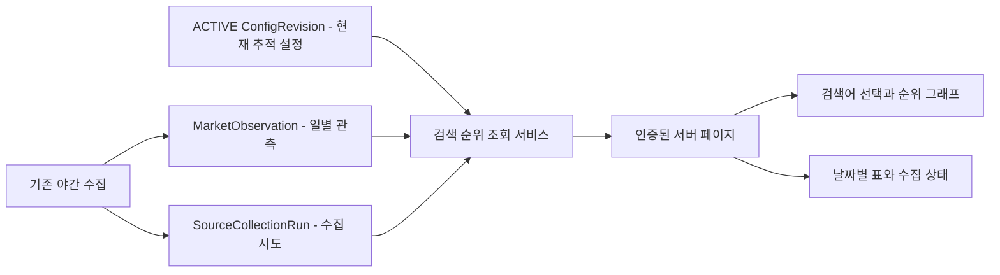

# 설계: 검색 순위 웹 조회와 시각화

- 설계 ID·버전: `BO-KEYWORD-WEB-20261012-v1`
- 상태: v1 승인, 구현 진행. 운영 배포는 요청 범위 밖.
- 기준 소스: Backoffice `f7682393443e3a6d0436af7ad3d4dafb4b30341e`
- 중앙 개발 계약: `.github` `992d2aff8fc544c64443a91bb63475902bae5ed5`
- 승인자·시각·근거·승인 커밋: 사용자, 2026-10-12, 현재 대화의 “1번으로 진행해줘. 설계 v1대로 기존 DB 기록을 연결해서 구현하고, 검증 후 PR까지 올려줘.” 승인 커밋 `0e06a68ee97af727638040803a080d51ebb33231`.
- 관련 설계: [일일 검색 순위표 v3](../2026-10-11-ops-alert-card-copy/daily-rank-report.md), [야간 일정 v4](../2026-10-11-ops-alert-card-copy/nightly-schedule.md)
- 실행 티켓: [#459](https://github.com/seorilabs/seorilabs-backoffice/issues/459). PR·UI 검수는 실행 후 연결. 이 문서는 제품 검수 완료의 근거가 아니다.

## 목적·범위·근거

검색 순위를 Discord 보고서뿐 아니라 웹에서 날짜별로 탐색하고, 검색어별 변화와 수집 실패를 그래프로 확인한다. 사용자가 요청한 DB화는 이미 있는 일별 관측 저장을 재사용하여 충족한다.

| 현재 확인된 구현 | v1에서 추가할 사용자 동작 |
| --- | --- |
| `MarketObservation`에 앱·검색어·국가·KST 날짜별 관측을 upsert | 저장된 관측을 7/30/90일 범위로 조회 |
| `SourceCollectionRun`에 수집 시도·결과 기록 | 순위 미관측과 수집 실패를 구분해서 확인 |
| `/feedback?date=...#daily-search-ranks`의 날짜 고정 전체표 | 전용 `/feedback/keywords` 화면, 앱·국가·기간·날짜 이동 |
| `keywordMonitoring`의 전체 조합·이전 성공 관측 비교 | 최대 4개 검색어 추이 그래프, 날짜별 상세표와 수집 상태 표시 |
| 야간 수집 21:20, 보고서 21:40 KST | 웹에서 기존 일정을 정확하게 안내 |

포함: 기존 App Store 공개 검색 관측, 인증된 웹 조회, 현재 ACTIVE 설정의 검색어 목록, 그 검색어의 보존된 과거 관측, 기존 전체표와의 이동. 신규 테이블·마이그레이션·별도 수집기·유료 공급자는 필요하지 않다. 현재 설정에서 제거된 검색어의 DB 기록도 삭제하지 않는다. 제거된 검색어를 고르는 별도 기록 보관 화면은 v1 범위에 포함하지 않는다.

운영 설정·키워드·국가 수정은 기존 앱 통합 관리의 중앙 서비스 경계에서 계속 수행한다. 이 화면은 읽기 전용이다. Google Play 순위 수집, 실기기 App Store 검색의 측정, 운영 배포·스케줄 변경은 본 설계의 범위에 포함하지 않는다.

근거: `prisma/schema.prisma`, `src/lib/market/collector.ts`, `src/lib/market/keyword-monitoring.ts`, `src/lib/market/daily-ranks.ts`, `src/components/insights/FeedbackView.tsx`, `k8s/market-feedback-cronjobs.yaml`. 모두 위 기준 SHA에서 읽었다. 생산 DB의 현재 건수나 첫 정기 실행 성공을 본 조사로 확인한 것은 아니다.

Apple 공식 [Search API 문서](https://performance-partners.apple.com/search-api)는 국가별 storefront 검색과 최대 200개 결과를 명시한다. 앱의 관측 순서는 기존 `keywordRank`가 반환 배열의 앱 위치로 계산한 값이다. 공식 문서는 개인 기기의 검색 화면과 같은 순위를 보장하지 않으므로 현재 제품의 관측 고지를 유지한다.

## 사용자 흐름·화면 상태

시안은 모든 값을 예시로 명시하며, 설계의 화면 배치와 상호작용을 보여준다. 그래프·표의 샘플 수치는 운영 데이터나 검수 결과가 아니다.

- `/feedback`의 기존 전체표와 앵커는 유지하고, 제목 옆 조회 링크와 행별 `추이 보기`를 추가한다. 앱별 피드백 화면에도 같은 링크를 제공한다.
- 전용 화면: 앱·국가·기준일·7/30/90일 → 추이 그래프 → 기준일 순위표 → 선택 검색어의 최근 7일 수집 상태. 날짜별 그래프 값은 표로도 볼 수 있다.
- 앱을 지정하지 않고 직접 열면 추적 설정이 있는 표시 가능 앱을 이름순으로 한 개 선택하고, 그 앱 설정의 첫 국가를 선택한다. 기본 기간 30일, 기준일은 현재 KST 날짜다. 초기 선택을 URL로 정규화하고 화면에 명시한다.
- 현재 KST 일자에 수집이 아직 없으면 `미수집`과 예정 시각을 표시하고, 이전 날짜의 순위를 당일 값으로 가져오지 않는다. 과거 기준일을 고르면 해당 날짜의 관측을 표시한다.
- 한 앱·한 국가에서 검색어 최대 네 개를 선택한다. 최초 두 개를 선택하되 추적 검색어 수가 적으면 존재하는 것만 고른다. 전체 검색어는 순위표에 표시하고 그래프 선택은 표 행에서도 바꿀 수 있다.
- 그래프의 y축은 1위가 위, 200위가 아래다. 같은 축을 유지한다. 날짜가 없는 구간·결과 목록에 없는 날·실패일은 선을 끊고, 0위·201위로 변환하지 않는다. 단독 관측은 점으로 남긴다.
- 범례에는 검색어와 선 모양을 표시한다. 날짜별 상세값은 포인터·터치와 접근 가능한 표에서 확인한다. 요약과 단위·기간·출처가 항상 보인다.
- 로딩: 필터와 제목을 유지한 로딩 영역. 빈 상태: 검색어 미설정/기간 내 관측 없음/모든 관측이 목록 없음의 차이를 표시한다. 오류: 필터를 보존한 재시도와 수집 상태 링크. 취소·뒤로가기: URL 상태 복원.
- 360px에서는 필터를 줄바꿈하고 그래프를 실제 영역 크기에 맞춘다. 표만 독립 가로 스크롤을 허용하며, 페이지 전체는 넘치지 않는다. 200% 글자 크기, 키보드 선택·포커스, 큰 터치 영역을 검수한다.

## 구조·책임·의존성

예상 변경 경계:

| 경로 | 책임 |
| --- | --- |
| `src/lib/market/keyword-history.ts` | 기간 검증, DB 범위 조회, 날짜별 순위·상태 변환 |
| `src/components/insights/KeywordRanksView.tsx` | 필터·조회 결과·표의 화면 구성 |
| `src/components/insights/KeywordRankChart.tsx` | 역방향 순위 축, 최대 네 검색어, 결측 분리, 상세값·표 |
| `src/app/(app)/feedback/keywords/` | 인증된 전용 페이지·로딩·오류 경계 |
| `src/components/insights/FeedbackView.tsx` | 기존 전체표에서 전용 화면으로 연결, 수집 시간 표시 수정 |
| 앱별 피드백 페이지 | 동일 전용 화면에 앱을 고정한 링크 |
| `docs/qa/feature-inventory.json` | 새 기능과 기존 연결 기능을 최종 E2E에 등록 |

기존 `keywordMonitoring`의 기준일 비교와 상태 표시, 날짜 유틸, `splitSegmentsOnNull`, 앱 표시 범위, 인증 셸을 재사용한다. 일반 지표 차트를 순위용으로 바꾸는 리팩토링 없이 순위 축을 가진 작은 SVG 컴포넌트를 추가한다. 신규 차트 의존성을 설치하지 않는다. 새 API·DB 쓰기 경로도 만들지 않는다.

## 데이터·인터페이스·실패 처리

DB 정본은 기존 `MarketObservation`이다. 유일키는 `[appId, kind, target, country, day]`, `kind=keyword`, `target=검색어`, `day=KST 기준일`이다. 저장값 `value`의 `rank`, `resultCount`, `trackId`, `sourceUrl`, `observedAt`을 그대로 사용한다. 같은 날짜의 재수집은 최신 성공 관측을 대체하고 다른 날짜는 보존하는 현행 저장 규칙을 유지한다. 시도 이력은 `SourceCollectionRun`에 남는다.

URL 계약: `/feedback/keywords?app=<id>&country=<iso>&date=YYYY-MM-DD&days=30&term=<검색어>`이며 `term`은 최대 네 번 허용한다. 앱·국가·검색어는 현재 표시 가능 앱과 활성 설정 안에서 검증하고, 조작된 식별자로 숨겨진 앱의 데이터를 읽지 않는다. 잘못된 날짜·미래 날짜·기간·국가는 안전한 기본값과 짧은 안내로 정규화한다. 앱 변경 때 국가·검색어 선택도 새 설정에서 다시 검증한다. URL에 비밀값은 넣지 않는다.

반환 날짜별 점은 `{ day, rank, observationState, attemptState, observedAt, attemptedAt, sourceUrl }`로 표현한다. 관측과 시도 상태를 분리한다.

| DB와 시도 근거 | 그래프·표 표현 |
| --- | --- |
| 유효한 성공 관측, rank 1~200 | 해당 순위 점·선과 성공 관측 시각 |
| 성공 검색 관측에 명시적 `rank: null` | `결과 목록에 없음`, 수치점 없음 |
| 관측 없음, 마지막 시도 failed | `수집 실패`, 수치점 없음 |
| 관측 없음, 시도 running/needs_input/lookup empty | `수집 중` / `입력 필요` / `공개 리스팅 미확인` |
| 관측·시도 없음 | `미수집`, 기간의 날짜 격자는 유지 |
| 성공 관측 후 같은 날 최신 재시도 실패 | 기존 성공값과 그 시각을 보존해서 표시하고 `최근 재시도 실패`를 함께 표시 |
| rank 필드 누락·범위 밖·잘못된 자료형 | `관측 형식 확인 필요`, 목록 없음으로 오인하지 않음 |

시도는 `startedAt`의 KST 날짜와 기존 `collectionTarget`으로 묶는다. 실패 때문에 저장된 정상 관측을 제거하지 않는다. 그래프에는 확인된 성공 관측을 그리며, 기준일 표에 최신 시도 상태를 별도로 보인다. 기존 일일 보고서의 규칙을 조용히 바꾸지 않는다. 이 의미 차이는 시각화 화면에서 `성공 관측 시각`과 `최근 시도` 라벨로 분리한다.

기준일 표의 변화는 전날을 가정하지 않고 실제 이전 마지막 성공 관측과 비교한다. 이전 관측일을 함께 표시하며 첫 관측·목록 진입·목록 이탈은 수치 증감으로 만들지 않는다. 현재 설정 버전은 현재 조회 범위의 설명이고 과거 관측 당시의 버전이라고 표시하지 않는다.

조회 범위는 최대 90일, 한 앱·한 국가·현재 추적 검색어 최대 30개다. 전체표 조회는 기존 서비스, 그래프 범위 조회는 기간과 대상 조건을 DB에서 제한한다. 조회는 고정 개수의 묶음으로 수행하며 날짜별 90회 호출을 하지 않는다. 원본 순위 자료는 최대 2,700개, 그래프 전달값은 최대 360개다. 수집 시도는 대상·기간을 제한하고 하루의 최신 시도만 묶어서 반환한다. 제한 초과 시 부분 자료를 완전한 기록처럼 표시하지 않고 조회 실패·범위 축소 안내를 제공한다.

화면 조회로 Apple Search API를 다시 호출하지 않는다. 브라우저의 새로고침이나 기간 변경은 수집을 시작하지 않는다. 통신 실패 재시도는 DB 읽기에 한정하며 기존 수집·보고서의 재시도·스케줄·알림 정책은 유지한다.

## 품질 요구사항·대안·결정

- 정확성: 순위와 관측 상태를 분리하고, 보간·전일값 채우기·평균 순위를 추가하지 않는다. 30일보다 기록이 적으면 존재하는 날짜와 빈 날짜를 함께 보인다. 수집 전 과거는 공식 현재 검색 API로 복원할 수 없으므로 만들어 넣지 않는다.
- 보안: 기존 인증과 앱 조회 범위를 적용한다. 앱 외부 입력은 서버에서 검증하며 키·권한·운영 설정을 바꾸지 않는다.
- 접근성: 색상만으로 검색어·실패를 구분하지 않는다. 표 대체값·날짜·단위·범례·키보드·터치를 제공한다.
- 성능: 로컬 격리 자료 최대 30검색어×90일에서 조회·응답 바이트 수와 시간, SQL 호출 수를 측정한다. 목표는 기존 인덱스를 사용한 범위 조회와 최초 응답 2초 이내이며 환경을 기록한다. 목표 초과는 무시하지 않고 인덱스가 필요하면 별도 데이터 변경 설계를 검토한다.

| 대안 | 판단 |
| --- | --- |
| 별도 순위 테이블·수집기 신설 | 동일 데이터가 이중 관리되므로 기존 DB 관측을 재사용 |
| 기존 전체표에 모든 앱의 선을 한 그래프로 추가 | 앱·국가·검색어가 섞여 읽기 어려워 전용 화면의 한 앱·국가 조회 선택 |
| 차트 패키지 도입 | 현재 SVG 관례로 충분하므로 의존성 추가 없음 |
| 순위 미관측을 201위로 그리기 | 실제 확인값이 아니므로 선을 끊고 상태를 따로 표시 |

## 인수조건·테스트·검수

| 조건 ID | 통과 기준 | 검증과 격리 자료 |
| --- | --- | --- |
| AC-1 | 기존 일별 관측 재사용, 새 저장 경로·스키마 변경 없음 | 조회 통합 테스트와 diff |
| AC-2 | 앱·국가·기준일·7/30/90일·URL 뒤로가기 일치 | 분리된 테스트 DB의 두 앱·두 국가, 실제 개발 브라우저 |
| AC-3 | 1위가 위, 최대 네 검색어, 단독 점·빈 구간 정확 | 1·200위·중간 결측·null·오류값 단위 테스트와 그래프 실행 |
| AC-4 | 미수집·실패·목록 없음·리스팅 미확인·형식 오류 구분 | 상태 변환의 실패 테스트 → 통과; 실제 화면과 표 |
| AC-5 | 성공 후 재시도 실패가 기존 성공 근거를 지우지 않음 | 같은 날 성공→실패·진행 중·중복 시도 자료 |
| AC-6 | 변화는 실제 이전 성공 날짜와 비교, 미래 자료 제외 | KST 자정 경계·다일 결측·첫 관측·진입·이탈 |
| AC-7 | 기존 전체표·앱별 화면 연결, 21:20 일정 안내 | 기존 경로·앵커 회귀, 새 경로 이동 |
| AC-8 | 모바일·큰 글자·키보드·터치·오류 복구 가능 | 360/1440px·200%·빈/로딩/오류/재시도 상태 |
| AC-9 | 미인증·숨겨진 앱·잘못된 URL이 자료를 노출하지 않음 | 기존 인증과 표시 범위의 통합 검증 |
| AC-10 | 최대 자료를 제한 안에서 조회, 페이지 새로고침이 수집하지 않음 | 2,700 관측·많은 시도 자료, 쿼리·네트워크 기록 |

TDD는 기간·점 변환·관측 유효성·상태·최근 실패·이전 성공 비교·조회 제한을 대상으로 요구사항 때문에 실패하는 테스트를 먼저 확인한다. 화면의 미적 배치는 단위 테스트로 완료할 수 없어 실제 실행·독립 검수를 대체 검증으로 한다.

구현 후 독립 에이전트가 실제 개발 서버와 격리 DB로 세 회차를 수행한다. 1회: 모든 AC와 처음 사용자 흐름. 2회: 오류·작은 화면·큰 글자·키보드·터치. 3회: 기존 피드백·설정·보고서 연결과 재시작·회귀. 매 회차 시작 전에 최신 후보 SHA·페르소나·자료·순서·기대 결과·근거 위치를 기록한다. 3회 이후 미완료면 추가 회차 승인 전에는 시작하지 않는다.

최종 후보에서 기존 기능 목록 전체와 새 검색 순위 기능을 E2E로 확인하고 중앙 검증기를 실행한다. 승인 설계 커밋·후보 SHA·웹 대상·설정 지문·격리 환경을 고정한다. E2E 통과 후 `pnpm typecheck`, `pnpm lint`, `pnpm build`와 관련 테스트를 실행한다. 설계·시안 확인은 제품 E2E나 이 세 회차를 대체하지 않는다.

## 적용·운영·되돌리기·승인

사람의 v1 승인 → 실행 티켓 → 테스트 우선 구현 → 3회 UI 독립 검수 → 최종 E2E·정적 검사·빌드 → 한국어 Ready PR·필수 검사·적용되는 리뷰 → 병합. 운영 반영은 별도 배포 승인 후 수행한다. 조회 화면은 같은 저장 모델을 사용하므로 마이그레이션·자료 재기입·수집 일정 활성화가 필요하지 않다.

복구는 승인된 배포 단계에서 이전 검증 이미지로 되돌리며, 순위 관측·시도·설정은 삭제하지 않는다. 설계 목록은 `docs/design/README.md`에 검토 대기로 연결한다. 승인 근거·문서 커밋·실행 티켓·PR·검수는 본 ID로 연결한다. Wiki·Obsidian에는 본문 복제 없이 정본 링크를 연결하며, 게시하지 않은 상태를 게시 완료라고 기록하지 않는다.

현재 상태: v1 사람 승인과 구현·행동 테스트 완료. 독립 검수 1·2회는 테스트 인증 환경에서 차단됐으며 3회차와 최종 E2E·PR이 남아 있다. 운영 DB readback과 배포는 수행하지 않았다.
