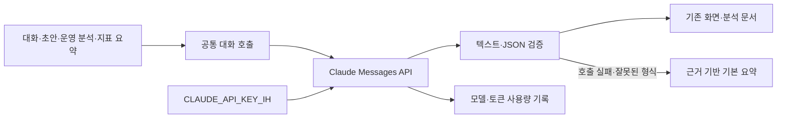

# 설계: Backoffice 분석·대화를 Claude API로 전환

- 설계 ID·버전: BO-CLAUDE-20261017-v1
- 상태: 연결 변경과 운영 Secret 등록 완료. 사용자의 후속 "배포 및 재시작까지" 지시에 따라 운영 배포·재시작·실제 호출 확인까지 진행한다.
- 조사 기준: Backoffice `b0b391d1e3eb9d03309d8b56e52ea973a149faff`, 중앙 개발 계약 `a2da27879d58da7f6e018be530162cb20e6273a1`.
- 구현 범위: 이 설계와 같은 폴더의 `test-plan.json`, 원본 커밋 `dbd38d8eb460f4a1d8da1699085b565cec0aa885`.
- 착수 근거: 사용자가 중앙 파일의 `CLAUDE_API_KEY_IH` 사용을 확인하고 연결 변경 작업을 직접 수행하라고 지시함. Sonnet 5.5는 작업 수행자가 아니라 Backoffice가 호출할 모델임을 설명함.
- 실행 티켓: [#468](https://github.com/seorilabs/seorilabs-backoffice/issues/468).

## 목적·범위·근거

MiniMax 대신 사용자가 지정한 `CLAUDE_API_KEY_IH` 하나로 Claude API를 사용한다.
현재 일반 대화는 `src/lib/ai/llm.ts`로 라우팅되지만 운영 분석은 MiniMax를 직접 호출한다.
웹 서버·운영 분석 작업기·Discord 명령 작업기의 설정을 함께 바꿔 호출 경로의 누락을 막는다.
Gemini 임베딩과 명시적으로 선택하는 Gemini 대화 지원은 유지한다.

## 구조·인터페이스·실패 처리

- 기본 공급자는 `anthropic`, 기본 모델은 `claude-sonnet-5-5`로 한다. 실제 키의 모델 목록 조회와 최소 생성 호출로 사용 가능 여부를 확인한다.
- 기존 MiniMax 클라이언트를 Claude 클라이언트로 대체한다. 공식 `https://api.anthropic.com/v1/messages`에 서버에서만 키를 전송한다. 키는 URL·오류·로그·프런트엔드에 넣지 않는다.
- 런타임은 정확히 `CLAUDE_API_KEY_IH`를 읽는다. 다른 이름의 키나 공급자로 자동 전환하지 않는다. 플래그·모델·시간 제한은 Claude용 환경변수로 명시한다.
- Sonnet 5.5는 기본값이 아닌 `temperature`를 거절하므로 기존 분석 호출의 `temperature: 0`을 그대로 전송하지 않는다. 추론 블록을 화면에 노출하지 않고 최종 텍스트만 사용한다.
- 기존 시스템 지시·JSON 검증·시간 제한·일일 호출 상한·동시 실행 2개·기본 요약 규칙을 유지한다. 잘린 출력·빈 응답·HTTP 오류는 성공으로 기록하지 않는다.
- 실제 공급자·응답 모델·입출력 토큰을 사용량 원장에 기록한다. Anthropic 출력 토큰에 이미 포함된 추론 토큰은 중복 합산하지 않는다. Sonnet 5.5 단가를 추가한다.
- 운영 분석·지표 요약의 모델 표기와 설정 화면의 공급자 안내를 수정한다. 화면 구조 개편은 없어 새 UI 검수 3회 대상이 아니다.
- MiniMax 직접 호출 코드·테스트·현재 실행 설정은 승인된 대체 범위에서 정리한다. 과거 사용량·가격·분석 기록과 기존 DB 동시 실행 슬롯 식별자는 보존한다. DB 스키마·저장 형식 변경은 없다.

## 품질·대안

운영 배포 전 실제 Claude 서비스 런타임 검증에서 합성 기획서가 기존 `maxTokens: 2048`을 모두 사용하고 `stop_reason=max_tokens`로 실패했다. 대화·분석용 한도는 유지하고 웹·Discord의 문서 초안 7종에만 공통 8192토큰 상한을 적용한다. 출력 한도는 사용량 할당이 아니며 완성에 필요한 만큼만 과금된다. 잘린 응답 거절·기존 호출 수·일일 상한·월 예산·시간 제한은 유지한다. 이 수정은 승인된 Claude 연결을 실제 사용 가능한 상태로 배포하기 위한 범위 내 결함 수정이다. 실패 실행을 보존하고 같은 합성 기획 입력과 나머지 초안 종류를 실제 API로 재검증한다.

새 SDK 의존성 없이 기존 `fetch` 패턴을 사용한다. 단순 URL 변경은 직접 호출·인증·모델 파라미터가 남으므로 채택하지 않는다.
공식 Sonnet 5.5 단가는 입력 100만 토큰당 $2, 출력 $10이다. 기존 MiniMax Coding Plan과 별도 API 과금이며 월 예산·호출 상한을 임의로 올리지 않는다.
실제 provider 오류 원문을 저장하지 않고 상태 코드 중심 오류를 사용한다. 개인 데이터나 업무 원문을 실제 연결 시험에 쓰지 않는다.

## 인수조건·테스트·검수

| 조건 | 관찰할 동작 | 개발 환경 검증 |
| --- | --- | --- |
| AC-1 | 기본 대화와 초안이 정확한 IH 키로 Claude를 호출함 | 가짜 HTTP 응답으로 URL·헤더·본문·모델·키 미노출 검사, 다른 키 이름만 있을 때 호출 거절 |
| AC-2 | 운영 분석·지표 요약도 공통 공급자를 사용함 | 분석 생성·오류 시 기본 요약·모델 및 공급자 기록 회귀 검사 |
| AC-3 | JSON·사용량·실패를 올바르게 처리함 | 텍스트 블록 선택, 출력 잘림·빈 응답·HTTP 오류·시간 제한, 토큰 집계·비용 검사 |
| AC-4 | 웹·두 작업기의 선언 설정이 일치함 | YAML 검사와 작업기 번들 빌드. 비밀값은 저장소에 추가하지 않음 |
| AC-5 | 지정 키로 실제 API를 사용할 수 있음 | 모델 목록 읽기와 비민감 최소 생성 호출. 키·잔액·운영 배포 검증과 구분 |

테스트 우선으로 동작 검사를 실패시킨 뒤 구현한다. K8s 선언은 정적 검사와 빌드로 검증한다.
등급은 L1, 실행 환경은 `dev`의 서비스 런타임이다. 관련 단위 테스트와 `pnpm typecheck`, `pnpm lint`, 더미 DB의 `pnpm build`, `pnpm build:scripts`를 실행한다.
네이티브·의존성·DB 변경이 없어 실기기 검수 대상이 아니다. 중앙 검증기가 더 높은 하한을 요구하면 필요한 실행을 추가한다.
자격증명 연결 변경은 로컬 Claude의 읽기 전용 교차 리뷰 대상이다. 키 값은 리뷰 입력에 포함하지 않는다.

## 적용·운영·되돌리기

최초 승인 범위는 격리 개발 검증과 Ready PR 작성까지였으며, PR #469는 사용자가 직접 병합했다. 운영 Secret은 후속 지시로 반영하고 PR #472로 암호문을 보관했다.
2026-10-17 사용자가 "배포 및 재시작까지 하고, 이 변경이 영향을 미치는 기능을 모두 리스트업해봐"라고 지시하여 `release.until`을 `public`으로 넓혔다. 이 지시는 웹·명령 작업기·기존 운영 분석 작업기의 동일 후보 적용과 재시작을 포함한다. 자격증명 회전·권한 확대·새 정기 작업 활성화는 포함하지 않는다.
배포 직전에 중앙 검증기를 실행하고 기존 등록 identity·SealedSecret 동기화를 확인한다. 기존 배포 workflow의 migration·감사 trigger·롤아웃 gate를 그대로 사용한다. 별도 관리되는 운영 분석 작업기는 live replicas와 운영 설정을 보존하며 image·Claude 설정만 갱신한다. 새 Pod의 imageID·설정과 실제 provider 사용 기록을 각각 확인한다. [기능별 영향 목록](../../CLAUDE_FEATURES.md)을 기준으로 대화·초안·다국어 출시노트·분석·기본 요약의 서비스 런타임 검증을 수행하고, Discord 전송이나 GitHub 이슈 생성은 시험 목적으로 실행하지 않는다.
키 원본은 이동·덮어쓰기·회전하지 않는다. 기존 MiniMax Secret은 현재 사용처 확인과 전환 검증 전 삭제하지 않는다.
오류 시 승인된 이전 후보와 실행 설정을 복구하며 다른 키로 자동 우회하지 않는다.

지정한 저장소 내 `claude-api-key.env`는 조사 시 존재하지 않았다. 사용자가 `~/.config/seorilabs/claude-api-key.env`와 그 안의 정확한 `CLAUDE_API_KEY_IH` 사용을 확인했다. 이 키로 공식 모델 목록 조회 HTTP 200과 `claude-sonnet-5-5` 제공을 확인했다. 키 값은 저장소에 넣지 않는다.

## 공식 자료

- [Claude Messages API](https://platform.claude.com/docs/en/api/messages/create)
- [Sonnet 5.5 사양·가격·파라미터 제한](https://platform.claude.com/docs/en/models/sonnet-5-5/overview)
- [API 인증](https://platform.claude.com/docs/en/api/overview)

Wiki·Obsidian에는 승인 뒤 정본 링크를 연결한다. 본문을 복제하지 않으며 실제 승인·검수 결과를 소급 작성하지 않는다.
