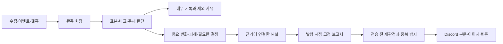

# Discord 자동 보고 개편

승인 근거: 2026-10-17 사용자가 이전 설계 전체를 구현·검수·병합·Backoffice 운영 배포·실제 Discord 보고 확인까지 실행하도록 지시했다. 개별 앱 출시와 기기 사용은 범위 밖이다.

## 목적과 흐름

모든 관측은 원장에 보존하고, 사람이 알아야 하는 결론이 있을 때만 발송한다. 횟수 제한은 두지 않는다. 메시지는 앱과 결론 → 비교 근거 → 의미 → 필요한 결정 순서다. 불필요한 가설·과제를 만들지 않는다.

## 책임과 데이터

- 공통 report-policy가 내부 기록·보고·긴급 사건·사용자 요청 응답을 구분한다. 각 생산자의 서버 계산 근거를 사용한다. 수집 완료/실패/회복, 작은 평점 변화, 출시 +1/+3/+7 단순 활성 기록은 제외한다.
- 관측과 감사 원장은 유지한다. NotificationDelivery에 SUPPRESSED와 사유·시각을 확장한다. 기존 ENUM 값의 순서와 데이터는 보존한다. MySQL의 ENUM 추가는 MODIFY가 필요하므로 정확한 SQL checksum을 기존 승인 목록에 등록하고 교차 리뷰·MySQL migration 회귀로 검증한다.
- 대기 메시지도 같은 정책으로 검사하며 제외는 성공·시도·전송 시각으로 집계하지 않는다. 이미 보낸 과거 메시지 일괄 편집/삭제는 하지 않는다.
- 동일 앱·기간·주제는 기존 멱등 키로 묶고, 같은 결론의 재계산은 재전송하지 않는다. 정정은 같은 카드를 갱신한다. 명령·승인 카드는 기존 대상·권한·버튼 경계를 유지한다.
- Claude는 비교 기간·수치·근거를 입력받고 선택적인 의미·행동만 작성한다. 실패 상태는 내부에 남기고 고정 가설이나 분석 진행 문장을 발송하지 않는다.
- 결제·광고 성공 건과 계정 생성 행은 내부 기록이다. 최초 실제 결제는 테스트/미확인과 분리한다. 지급 실패는 피해 근거와 앱을 보여준다. 수치 이상은 장애 확정과 구별한다.

## 검색 순위

21:40 KST 유지. 상위 10/20/50/100 진입·이탈, 지속 추세를 우선한다. 국가·검색어를 섞지 않는다. 최대 3개 핵심 비교와 최근 7일 그래프를 밝은 이미지로 보여주고 전체 보고서는 28일·CSV·같은 기준일 상세 링크를 제공한다. 발행 payload에 행·시계열을 고정하고 웹/본문/이미지는 이것만 사용한다. 미수집과 목록 밖을 구분하며 null을 201위로 그리지 않는다. 이미지 실패 시 본문과 링크는 발송하고 오류는 내부 기록이다.

## 인수조건·검수

L3 개발 환경 전체 회귀, 독립 검수 3회. 1회 판단: 소모수 평점·수집·회복·출시 단순 기록 제외, 실제 피해·승인·중요 변화 보존. 2회 보고서: 실제 자료 숫자·기간·링크·그래프 대조 및 작은 화면/큰 글자/밝고 어두운 배경. 3회 전체 흐름: 중복·정정·재시도·과거 대기·분석/이미지 실패·명령/버튼·결제/장애와 전체 기능 회귀. 각 회차 전 계획과 증거·검수자를 기록한다. pnpm test/typecheck/lint/build, migration 계약과 중앙 검증기를 실행한다.

## 적용·복구

최신 main 격리 worktree → 한국어 Ready PR → 교차 리뷰 → CI → 병합 → 정확한 SHA 이미지 → 호환 migration → 웹/알림/인사이트 worker와 CronJob → 실행 digest readback → 유용한 실제 보고 1건의 Discord 본문/이미지/버튼/readback. 새 보고는 NOTIFICATION_REPORTS_PAUSED=true로 중지할 수 있고 긴급 피해·승인·명령 응답은 유지한다. 스키마와 원장은 되돌리거나 삭제하지 않는다. 별도 승인이나 검증기 차단은 그대로 기록한다.
