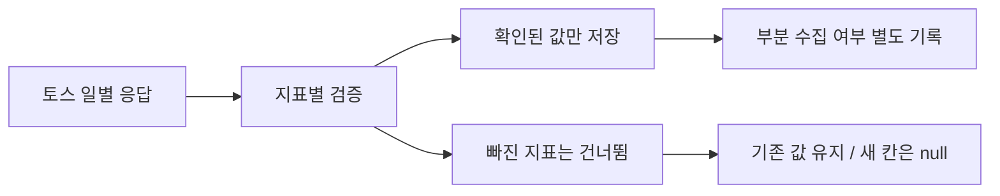

# 앱인토스 결측 지표만 건너뛰고 확인된 값 저장

상태: 2026-10-18 사용자의 직접 수정 지시("일별 행 하나라도 없으면 그 날짜 전체저장을 보류하는 로직은 고쳐야하는거 아냐? 스킵하도록")에 따른 구현·개발 검증·PR·병합 범위. 운영 배포와 운영 DB 변경은 포함하지 않는다. 테스트 계획의 service/public은 향후 운영 후보의 검증 목표이며, 이번 수정 지시나 이 문서만으로 운영 배포를 승인받았다는 뜻이 아니다. 운영 배포에는 별도 사용자 지시가 필요하다.

## 문제와 결정

10/17 운영 수집은 9개 리스팅에서 66행을 반영했지만 광고 OS나 결제 행 부재 때문에 438개 리스팅·날짜를 통째로 제외했다. 지표 수집·정규화·저장·집계만 변경한다. 화면 구조·인증·스케줄·모델·결제 실행은 바꾸지 않는다.

- 정상인 DAU·세션·광고·결제는 독립 저장한다. 값이 전부 없으면 그 날짜를 건너뛴다.
- 광고·결제 컬럼을 nullable로 확대하고 숫자 기본값을 제거한다. 기존 행과 확인된 0은 보존하며 과거 값을 추정 변경하지 않는다.
- 업데이트는 확인된 필드만 바꾼다. null·생략 값은 기존 값을 지우지 않는다. OS별 원본은 병합하고, 두 OS가 확인됐을 때만 광고 합계를 만든다.
- 잘못된 값·날짜·중복·자격증명은 기존 검증으로 거부한다. 결측은 0이 아니다.
- 부분 행은 전체 관측 완료로 기록하지 않는다. 오류·결측·정상 반영 건수와 수집 상태를 구분한다. 최근 날짜가 전진해도 전체 완료로 단정하지 않는다.
- 조회·집계·기존 표시에서 null을 지원한다. 월별 광고 관측 일수는 광고가 확인된 행만 센다. 미확인 값은 —로 표시한다.

## 인수조건과 검증

AC-1: IOS 광고/결제가 없어도 확인된 지표를 저장한다. 모든 지표가 없으면 행을 만들지 않는다.
AC-2: 재수집의 null·생략·실패가 기존 값·다른 OS 원본을 지우지 않고, 명시적인 0은 갱신한다.
AC-3: 부분 행을 observed/전체 완료로 승격하지 않는다. 중복 날짜·잘못된 숫자·비밀 원본 차단을 유지한다.
AC-4: 기존 값과 키를 보존한 실제 MySQL migration 및 HTTP MCP→수집→DB 재조회가 통과한다.
AC-5: 기존 보고·월별 광고 집계는 null을 0 또는 완전 관측으로 표현하지 않는다.

저장 형식 변경이므로 L3/dev: 동일 후보의 전체 단위 회귀는 CI, 변경 서비스 흐름은 독립 실행자가 격리 MySQL에서 검증한다. 테스트 우선으로 AC-1/2 실패를 확인한다. typecheck·lint·build·build:scripts·migration 안전 검사와 기존 DB 계약 검증을 실행한다. 기기 검증은 필요 없다. 운영 OAuth·Discord·DB에는 시험 쓰기를 하지 않는다.

## 적용과 복구

PR 병합까지 수행한다. 운영 반영은 별도 배포 승인 후 DB 백업·복원 검사와 중앙 검증기를 통과한 후보만 적용한다. nullable 확장이므로 기존 값은 유지하지만 구 버전 reader는 null을 처리하지 못하므로 새 worker 활성화 전에 reader를 함께 갱신해야 한다. 되돌릴 때 null을 0으로 바꾸거나 열을 축소하지 않는다.
