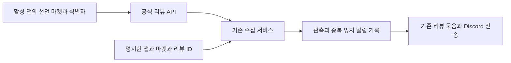

# 사용자 리뷰 수집 누락 수정

상태: 사용자 직접 지시 「코드와 운영상태 변경해」에 따라 앞서 확인한 수집 조건 수정, 블룸핸드 누락 리뷰 2건 복구와 운영 배포를 수행한다. 승인 범위의 구현과 L1 개발 검증을 이 문서에 구체화한다. 새 화면, 스키마, 앱 단계 변경은 없다.

## 근거와 결정

2026-10-19 0시 운영 작업은 Google Play 10개와 App Store 10개 대상에서 성공했다. 블룸핸드는 ACTIVE이며 play와 appstore 및 식별자가 있지만 PLANNING 단계라는 이유로 제외됐다. 수집과 관측 이력은 없다. 공식 Google API가 반환한 리뷰 ID 7b7f502e-5102-454f-ab13-bec76e3c8847, 8f355a74-896d-4e32-84ba-db811df30dd8을 복구한다. App Store는 0건이다.

수집 대상은 ACTIVE, 선언 마켓, 해당 마켓 식별자로 정한다. 개발 단계는 출시 사실이나 리뷰 유무의 근거로 사용하지 않는다. 미등록 앱의 공식 API 실패는 기존 앱별 실패 기록에 남기고 다른 앱은 계속 처리한다. 단계값을 임의로 승격하는 대안은 채택하지 않는다.

평상시 최초 수집의 기준선 정책은 유지한다. 복구 실행은 앱 slug, 마켓, 리뷰 ID를 모두 명시해야 하며 다른 앱과 마켓은 처리하지 않는다. 요청한 ID가 API에 없으면 해당 수집은 실패한다. 이미 만들어진 동일 알림이 있으면 payload나 묶음 상태를 갱신하지 않아 재실행이 중복 분석이나 전송을 만들지 않는다. 기준선에 먼저 기록된 리뷰도 알림이 없으면 기존 enqueue 경로로 복구한다. 기존 관측, 기준선과 중앙 설정은 삭제하거나 직접 수정하지 않는다.

## 인수조건과 검증

- AC-1: 개발 단계와 무관하게 활성 앱의 선언 마켓과 식별자에 맞는 대상을 수집한다. 비활성 앱, 미선언 마켓, 식별자 없는 마켓은 제외한다.
- AC-2: 기본 실행은 첫 기준선을 조용히 만들고 다음 신규와 수정 리뷰만 알린다.
- AC-3: 복구는 앱과 마켓과 리뷰 ID로 제한된다. 잘못된 인자, 대상 없음, API에 없는 복구 ID는 실패하며 다른 앱으로 확대하지 않는다.
- AC-4: 새 기준선 및 기존 기준선의 누락 ID를 복구하고 재실행과 enqueue 실패 뒤 재시도에도 중복 알림을 만들지 않는다.
- AC-5: 앱별 API 실패를 기록하고 다른 앱의 수집은 계속한다.

L1, service-runtime, 격리 메모리 저장소와 고정 리뷰 fixture로 수집부터 관측, enqueue, 재실행과 실패 복구를 검증한다. AC-1과 AC-3/4는 변경 전 실패를 확인한다. typecheck, lint, build와 scripts bundle을 실행한다. 화면과 기기 의존 변경이 없어 별도 화면 검수와 기기 사용은 해당 없다. 알림 무결성에 영향을 주는 복구 경로는 로컬 Claude 교차 리뷰를 받는다.

## 적용과 복구

Ready PR과 필수 검사를 통과한 후보를 병합하고 중앙 개발 근거 검증 뒤 기존 Deploy workflow로 운영 배포한다. CronJob의 image digest와 스케줄을 읽어 확인한다. 같은 후보의 수집 CLI로 블룸핸드 Google 리뷰 2건을 복구하고 DB 재조회로 관측과 중복 방지 기록을 확인한다. Discord 개별 원문은 기존 정책대로 내부 기록이며 닫힌 15분 묶음의 분석 결과가 user-reviews에 전송되는지 별도로 확인한다. 이 알림 정책은 바꾸지 않는다.

실패 시 새 수집 실행을 중단하고 기존 immutable image로 되돌릴 수 있다. 이미 기록한 관측과 알림은 삭제하지 않는다. 데이터 복원이나 자격증명 변경은 포함하지 않는다. Version Impact: patch.
