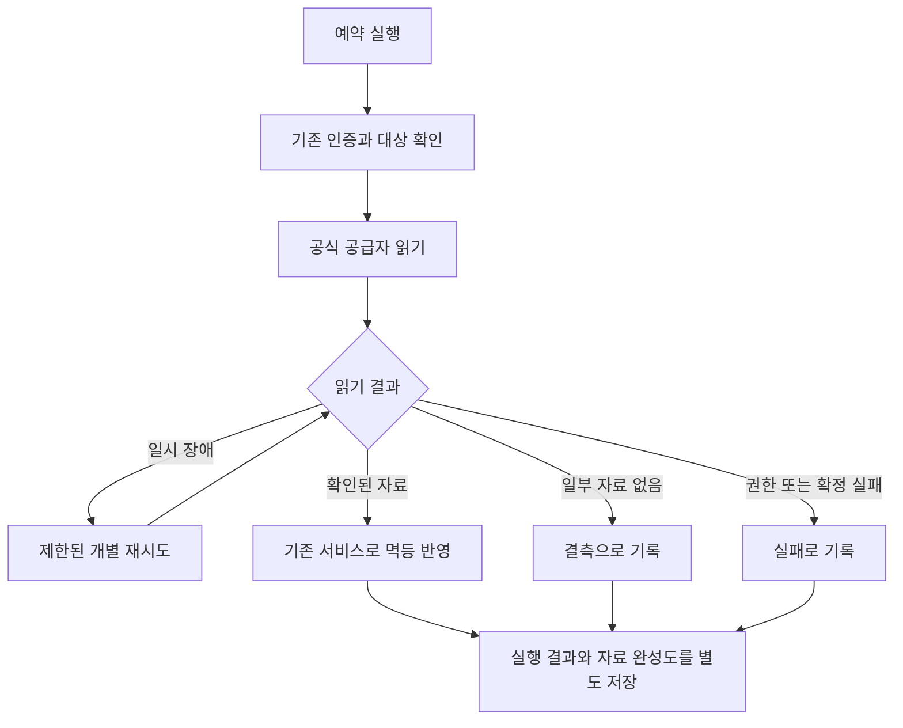

# 예약 작업 실패 원인과 대응 설계 v1

- 상태: 사람 검토 대기. 구현, DB 수정, 수동 수집, 알림 발송, 배포는 아직 하지 않았다.
- 기준: 원격 main `ac78fe929726fafb7c3c3226b9a10bce7b9effc5`, 중앙 계약 `1f3780179c7d1d5fb60a97b9688f2076f22e5205`.
- 조사일: 2026-10-22 KST. 운영 재조회 시각은 [runtime-observations.json](runtime-observations.json)의 `observedAt`에 기록했다.
- 대상: `platform`의 Backoffice 예약 작업 4종, `tasks/trends-news`.
- 원본 구현: Backoffice와 별도 저장소 `fundevel/cronjobs`의 `3f2477edf29faea698507aeb04e91387c99a0561`.
- 승인자, 승인 시각, 승인 커밋, 실행 Issue와 PR: 승인 뒤 기록한다.

## 확인한 원인과 한계

| 작업 | 확인한 사실 | 판정과 대응 |
| --- | --- | --- |
| `backoffice-ait-console-metrics` | 최근 3회 모두 `partial`, exit 2. 회당 71건 반영, 조회와 저장 오류 0건. 첫 두 실행의 결측은 114개, 113개 리스팅과 날짜 조합이다. | 인증 장애가 아니다. 결측과 실행 오류를 구분하고 실제 누락도 줄인다. |
| `backoffice-reconcile` | 10월 22일 03시, 09시, 15시 KST와 각 재시도에서 `merge-lizard`의 `issue_mirror_repoFullName_number_key`, Prisma `P2002`가 반복됐다. | 동일 주소의 Issue #18에 오래된 GitHub 식별자가 남아 새 Issue를 저장하지 못한다. 반복 실행만으로 복구되지 않는다. |
| `backoffice-extended-metrics` | 10시 첫 시도의 수집 원장 64개 연결 중 observed 26개, not_landed 35개, failed 3개. 새 배치 53개. spiritgate-defenders와 reascend는 `PLAY_VITALS_HTTP_503`, cycle-pair의 Apple 수집은 `SOURCE_TIMEOUT`. | Pod 로그가 없어도 저장된 원장에서 공급자 오류를 확인했다. 개별 읽기 재시도가 없고 컨테이너 전체 재시도가 반복된다. |
| `backoffice-metric-daily-reconcile` | 10월 21일 23:45 시작, 웹 Pod가 같은 시각 23:45:16에 `OOMKilled`, exit 137로 재시작. 이 작업은 23:45:31에 실패 판정됐다. 메모리 상한 768MiB. | 웹 프로세스의 메모리 부족은 확정이다. 해당 요청이 어떤 할당에서 상한을 넘겼는지는 미확정이며 격리 재현으로 측정한다. |
| `trends-news` | 마지막 Job 성공 기록은 10월 9일. 최신 실행에서 첫 키워드는 Backoffice 수신 승인까지 받았고 다음 키워드의 Gemini 요약이 503으로 중단됐다. | Job 실패를 뉴스 전체 미전송으로 해석하면 안 된다. API 예외가 JSON 검증용 재시도 바깥에서 발생하고 한 키워드 실패가 뒤의 키워드도 막는다. |

### AppsInToss 공급자 응답 재확인

현재 MCP의 워크스페이스 38345 접근을 확인하고 `crossword-puzzle #56407`의 10월 20~21일을 읽었다.

- Android 광고 응답은 `dailyReports: []`다.
- iOS는 10월 21일 노출 1회, 추정 수익 4원이다.
- OS를 생략한 공식 합계도 10월 21일 노출 1회, 추정 수익 4원이다.
- DAU는 두 날짜 모두 3명이다.
- 현재 mapper는 양 OS 행이 있어야 합계를 계산하므로 확인 가능한 4원이 합계 컬럼에 들어가지 않는다. iOS 원값은 `raw.iaaByOs`에 남는다.
- 빈 날짜나 빈 OS 응답을 0으로 바꿀 근거는 없다. 공급자 지연과 실제 활동 없음의 구분도 현재 응답만으로 확정하지 않는다.

### GitHub 식별자 충돌 재확인

현재 `merge-lizard` 저장소 생성 시각은 `2026-10-14T23:05:58Z`, repository ID는 `R_kgDOVKKJBg`다.
DB의 #18은 7월 30일 생성된 `I_kwDOTaV0W88AAAABK3__Og`, 현재 공식 #18은 10월 18일 생성된 `I_kwDOVKKJBs8AAAABYFE5Cw`다.
오래된 node의 GraphQL 조회는 NOT_FOUND다. 저장소 이름은 같은데 오래된 미러가 남은 상태와 일치한다.
DB에는 Issue 23개, 현재 공식 목록에는 8개가 있다. 전체 과거 미러 삭제는 이번 범위가 아니다.

### 보고서 메모리 조사

최근 원본 배치 1,211개의 저장 JSON은 합계 18.5MiB, 보고서 본문은 최근 날짜마다 약 2.5MiB다. 이 값은 메모리 사용량 측정값이 아니다.
현재 정정 경로는 최근 보고서 본문들을 한꺼번에 읽고, 날짜마다 원본을 재구성하며 사실이 같은지 확인하기 전에 PNG를 만든다.
`dailyReportImage`는 여러 PNG를 동시에 만든다. JSON 파싱, 문서 복제, PNG와 네이티브 이미지 메모리 중 어느 쪽이 원인인지 측정이 필요하다.
운영 코드와 최신 코드의 이 경로에는 차이가 없다. 단순히 최신 이미지를 배포하면 고쳐진다고 볼 수 없다.
웹 Pod의 source label은 `ad9a5ea`다. 이 커밋과 main `ac78fe9`는 커밋 계보가 다르지만 전체 소스 트리가 같다. 테스트 기준은 main의 조상인 동등한 `ac78fe9`로 고정한다.

## 동작과 책임

새 화면은 없다. 운영자는 기존 수집 원장, 로그와 작업 상태에서 완료, 부분 완료, 실패를 구분한다.

### 1. GitHub 미러 복구

- `src/lib/sync/mirror.ts`의 Issue 저장 서비스에서 식별자 충돌을 다룬다. DB 수동 UPDATE나 고유키 제거로 우회하지 않는다.
- 같은 `repoFullName + number`인데 node ID가 다르면 GitHub의 현재 Issue를 다시 읽는다. 늦게 도착한 과거 webhook으로 새 Issue를 덮어쓰지 않는다.
- 공식 재조회가 확인한 현재 식별자만 반영한다. 재조회 실패, PR로 바뀐 대상, 다른 저장소 응답은 자동 교체하지 않고 원인을 남긴다.
- 교체 전 미러 전체 스냅샷과 현재 공식 식별자를 같은 트랜잭션의 감사 기록에 보존한다. 이전 Issue의 로컬 생성 마커와 연결 PR 정보는 새 Issue에 넘기지 않는다.
- 기존 queue, lease, 실행, Project의 옛 Issue node ID를 새 Issue로 재연결하지 않는다. 현재 Issue의 투영만 기존 서비스로 재생성한다.
- 동일 node 동시 upsert 충돌은 같은 식별자로 제한해 재확인한다. unrelated unique 오류를 삼키지 않는다.
- 충돌하지 않는 과거 미러의 일괄 삭제와 저장소 세대 모델의 전면 변경은 제외한다.

### 2. AppsInToss 수집

- 광고 읽기에 OS를 생략한 공식 일별 합계 1회를 추가한다. OS별 원본 조회도 유지한다. 리스팅당 호출은 5회에서 6회가 되고 동시 요청 상한 2개, 잠금과 요청 제한 중단은 유지한다.
- 공식 합계의 명시적 일별 행이 있으면 합계 필드에 사용한다. 합계 응답이 없을 때는 기존처럼 양 OS의 명시적 행이 있을 때만 계산한다.
- 합계와 OS별 자료 완성도를 별도로 기록한다. 합계 확인을 근거로 누락 OS의 관측 여부를 지우지 않는다. 이후 미확인 응답이 기존 확인값을 지우지 않는다.
- `SourceCollectionRun`에 실행 요약과 결측 범위를 남긴다. 정상 읽기와 저장 후 공급자 결측만 남으면 실행 종료는 0, 자료 상태는 `partial`로 보존하는 변경을 제안한다. 알림과 자료 완성도는 완료로 바꾸지 않는다.
- 인증, 실행 잠금 상실, 조회 오류, DB 반영이나 결과 기록 실패는 exit 1이다. 부분 실패를 성공으로 바꾸지 않는다.
- 날짜별 IAP 빈 응답, 오래된 리스팅의 비활성 여부는 추정하지 않는다. NULL을 유지한다.

### 3. 확장 지표 수집과 실패 근거

- Google Play와 Apple의 조회 전용 경계에 제한된 재시도를 적용한다. HTTP 429, 500, 502, 503, 504와 timeout에 최초 포함 최대 3회, 요청별 시간 제한과 전체 예산을 둔다.
- `Retry-After`가 있으면 우선하되 실행 예산을 넘으면 중단한다. 그 외 지수 간격과 작은 무작위 지연을 사용한다. 400, 401, 403과 identity 불일치는 재시도하지 않는다.
- 이 변경은 조회 전용 요청에 한정한다. 심사 제출, 빌드 실행, OAuth refresh, 알림 발송에 공용 재시도를 확장하지 않는다.
- 이미 저장된 배치는 기존 원천 버전과 날짜 키로 중복을 제거한다. 실패는 대상과 오류 코드로 원장에 남기고 다른 연결 수집은 계속한다.
- 확장 지표와 보고서 정정 CronJob의 `restartPolicy`를 `Never`로 바꿔 컨테이너 재시작에 의존하지 않는다. 실패 시도별 Pod를 Job 이력과 함께 보존한다. `terminationMessagePolicy: FallbackToLogsOnError`와 비밀값 없는 결과 요약을 사용한다.
- 오래된 `running` 원장은 이번 조사에서 읽기만 했다. 자동 만료 판단은 해당 실행의 소유권과 종료 증거를 결합할 때만 수행한다.

### 4. 보고서 정정 메모리

- 현재 768MiB 상한의 격리 환경에서 8일치 정정을 재현하고 RSS, heap, 외부 메모리와 날짜별 최고값을 측정한다. 운영 DB 쓰기와 실제 Discord 전송은 연결하지 않는다.
- 최근 대상은 날짜만 조회하고 본문은 한 날짜씩 읽는다. 원본 배치도 필요한 최신 partition을 제한된 묶음으로 읽고 처리한 참조를 다음 날짜까지 붙잡지 않는다.
- 사실이 같으면 PNG 생성을 생략한다. 바뀐 날짜만 렌더링하고 기존 버전 잠금과 사실 재검사를 유지해 동시 정정 중복을 막는다.
- 이미지 생성 동시 실행 수를 제한한다. 측정 결과에 따라 해당 경로의 큰 배열 복제를 줄인다. 메모리 제한 상향이나 새 worker 도입은 이번 기본안에 넣지 않는다.
- 같은 입력에서 버전과 outbox 중복이 늘지 않고, 변경된 입력은 같은 메시지의 버전과 이미지만 정정해야 한다.

### 5. trends-news MiniMax 전환

- 기사 수집은 Naver 검색과 본문 읽기를 유지한다. 요약만 MiniMax의 Anthropic 호환 API로 옮긴다. 추천 모델은 조사 당시 공식 문서의 `MiniMax-M3.1-Flash`, 낮은 thinking effort다. 실제 허용 모델은 키 권한으로 확인한다.
- 기사 id와 link, 항목 개수, 중복 id를 검증하는 기존 규칙을 유지한다. 모델이 반환한 JSON을 검증하지 않고 전송하지 않는다. 응답 잘림과 JSON 불일치를 처리한다.
- API 일시 오류 재시도와 JSON 검증 재생성을 구분한다. 호출 수와 총 실행 시간을 제한한다.
- 기존 `gemini-embedding-2`, 768차원 임베딩과 유사도 기준은 유지한다. 임베딩 읽기에도 일시 장애 재시도를 적용한다. 임베딩 모델을 교체하면 기존 벡터와 비교할 수 없으므로 별도 마이그레이션으로 다룬다.
- 키워드 한 건 실패 뒤 다른 키워드는 계속 처리하고 최종 요약에 실패 대상을 남긴다. 일부 실패는 Job 실패로 남긴다. Backoffice 수신 승인 뒤 sent 표시를 유지하며 성공한 기사를 다시 보내지 않는다.
- 수동 실행은 알림 전송 없는 격리 검증만 한다. 운영 반영 뒤에는 기존 자연 스케줄의 수신 결과를 읽어 확인한다. 이번 조사가 수동 뉴스 발송의 승인은 아니다.
- 현재 카탈로그에서 확인한 MiniMax 키는 `shared/minimax/coding-plan-api-key`이고 등록 목적은 PR 리뷰와 시각 자산이다. 뉴스 운영 소비자는 등록돼 있지 않다. 일반 운영 API 권한 확인이 선행 조건이며 키 생성, 교체나 복제는 이번 승인에 포함하지 않는다.
- MiniMax도 일시 오류가 발생할 수 있다. 공급자 교체만으로 재시도와 부분 실행 문제를 해결했다고 보고하지 않는다.

## 대안과 결정

| 선택 | 판단 |
| --- | --- |
| 모든 Job을 통째로 재실행 | 이미 성공한 조회도 반복하고 충돌과 메모리 부족은 해결하지 못한다. 개별 읽기 재시도를 우선한다. |
| AppsInToss 빈 날짜를 0으로 저장 | 근거가 없어 제외한다. 공식 합계의 명시적 날짜만 추가로 수집한다. |
| 충돌 행 수동 삭제 | 과거 근거 손실과 재발 가능성이 있어 제외한다. 서비스에서 공식 재조회와 감사 기록을 사용한다. |
| Gemini 요약만 재시도 유지 | 변경이 작다. MiniMax 운영 권한이 준비되지 않으면 이 안으로 먼저 안정화할 수 있지만 공급자 전환 완료로 보고하지 않는다. |
| MiniMax 요약과 Gemini 임베딩 | 요약 503 의존을 줄이면서 기존 중복 제거 자료를 유지한다. 운영 키 권한이 준비될 때 채택한다. |

## 인수조건과 테스트

테스트 등급은 L1, 개발 서비스 환경이다. 화면과 모바일 기기는 대상이 아니다. 관련 테스트를 먼저 실패시킨 뒤 구현한다.

| ID | 통과 기준 | 격리 검증 |
| --- | --- | --- |
| AC-1 | 현재 #18 식별자로 수렴하고 옛 이벤트가 되돌리지 않음. 원본 감사와 기존 queue 식별자 보존 | 가짜 GitHub 응답, 격리 DB, 동시 upsert와 API 실패 |
| AC-2 | Android 빈 배열, iOS 4원, 공식 합계 4원이면 합계 4원 저장. 없는 날짜는 NULL, 기존 확인값 보존 | mapper와 ingest 통합 검증, 6개 allowlist 호출과 429 중단 |
| AC-3 | 공급자 결측은 `partial`, 실제 읽기나 저장 실패는 실패로 남음 | CLI exit과 원장 상태의 조합 검증 |
| AC-4 | 503 뒤 200은 복구, 401은 1회만 실행, 재시도 예산과 Retry-After 준수, 저장 중복 없음 | Play와 Apple 응답 대체, 가짜 시계 |
| AC-5 | 8일 정정이 768MiB 컨테이너에서 종료되고 최고 RSS 600MiB 이하. 동일 사실은 이미지 생성 0회, 변경 사실만 버전과 이미지 정정 | 현재 규모 이상의 원본 배치와 2.5MiB 보고서 fixture, 동시 정정 검증. 초과하면 미통과 |
| AC-6 | 실패 Pod 종료 요약과 대상별 원장 근거를 다시 읽을 수 있음 | manifest 검사, 격리 서비스 런타임 |
| AC-7 | MiniMax 요약의 id, link, 개수 검증, 응답 잘림, 503 재시도, 키워드 실패 격리와 중복 전송 방지 | `fundevel/cronjobs`의 격리 DB와 가짜 공급자, 알림 수신기. 실제 외부 발송 없음 |

- Backoffice 필수 검사: `pnpm test`, `pnpm typecheck`, `pnpm lint`, 더미 `DATABASE_URL`의 `pnpm build`.
- 뉴스: 실제 예외를 다루는 테스트를 추가하고 `npm test`, `npm run build`. 현재 `npm test`는 타입 검사뿐이므로 이것만 통과했다고 동작 검증으로 세지 않는다.
- 뉴스 저장소별 승인 원본은 `fundevel/cronjobs`의 `docs/design/2026-10-22-news-summary/design.md`와 같은 폴더의 `test-plan.json`이다. 공통 장애 조사는 이 문서를 참조한다.
- 변경 파일에 따른 중앙 하한이 올라가면 개발 환경 검증을 추가한다. 기기 검증은 필요하지 않다.
- JSON 응답 대체 테스트는 실제 공급자 상태가 회복됐다는 증거로 세지 않는다.
- MiniMax 실제 품질 확인은 등록된 운영 범위의 키가 준비된 뒤 공개 기사 소수, 알림 전송 없이 수행한다. 현재 미실행이다.

## 적용, 운영 확인, 되돌리기

1. 설계와 테스트 계획 승인 뒤 저장소별 실행 Issue와 PR을 만든다. Backoffice PR은 Ready, 한국어, 필수 로컬 리뷰와 CI를 따른다.
2. GitHub 충돌 복구와 조회 재시도, AppsInToss 합계 수집, 보고서 메모리 수정을 각각 검증한다. 구조를 넓히는 변경은 재검토한다.
3. 승인 범위가 운영 반영을 포함할 때만 동일 후보의 중앙 서비스 배포 검증을 통과하고 대상 웹과 CronJob에 고정 이미지를 적용한다. 관련 없는 worker의 이미지 차이를 함께 맞추지 않는다.
4. 자격증명 생성, 교체, 과거 지표 삭제, 수동 뉴스 발송, 보고서 수동 재발송은 제외한다. MiniMax 키가 준비되지 않아도 Backoffice 복구는 독립적으로 마친다.
5. 다음 자연 실행에서 GitHub 충돌 없음, 수집 원장의 상태와 반영 수, 웹 재시작 증가 없음, 메모리 사용과 뉴스별 처리 결과를 다시 읽는다. 단순 HTTP 200이나 Job 완료만으로 자료 완성을 주장하지 않는다.
6. 문제 시 바뀐 workload만 이전 고정 이미지로 되돌린다. 이미 저장된 확인값과 감사 기록은 지우지 않는다. 과거 Issue 식별자를 현재 값으로 다시 되돌리지 않는다.

테스트 계획의 `release`는 승인 요청안이다. 현재 운영 반영 승인은 대기 상태다. 사람이 구현과 PR까지만 승인하면 그 범위에서 멈추며 배포를 수행하지 않는다.

## 공식 참고

- [MiniMax 모델과 API](https://platform.minimax.io/docs/guides/text-generation): 요약 호출과 지원 모델.
- [MiniMax 운영 용도와 키 구분](https://platform.minimax.io/docs/m-plan/faq): 일반 운영에는 종량제 API 권장, 구독 키와 일반 키 구분.
- [Gemini 오류 대응](https://ai.google.dev/gemini-api/docs/troubleshooting): 503은 일시 과부하, 지수 간격 재시도 권장.
- [GitHub node ID](https://docs.github.com/en/graphql/guides/using-global-node-ids): REST와 GraphQL 객체 식별자 조회.

AppsInToss 수치는 연결된 공식 Console MCP를 직접 조회했다. 자격증명 값과 외부 API의 인증 헤더는 조사 문서에 저장하지 않는다.
