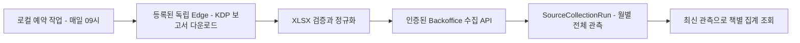

# 책 판매 예약 수집 v1

- 상태: 승인된 대화 범위의 실행 설계. 2026-10-23 사용자가 판매 집계 제안을 받은 뒤 작업 진행을 지시했다.
- 기준: `e6d5d23ec193c1662153de875e794e3b5aed5726`.
- 실행 티켓: [#524](https://github.com/seorilabs/seorilabs-backoffice/issues/524).
- 범위: Amazon KDP 원본 보고서 다운로드, 책별 판매량과 환불, 무료 주문, 예상 로열티와 Kindle+ 페이지 집계, 매일 09:00 KST 실행, 인증 실패 기록, 운영 API 조회.
- 다른 판매처의 실제 판매 여부와 인증 연결은 미확인이다. Leanpub 유료 요금제 가입, 책 출판과 계정 설정 변경은 포함하지 않는다.

## 확인한 입력과 구조

KDP에서 등록 계정으로 비밀번호와 사용자 제공 인증번호를 사용해 로그인했고, `kdpreports.amazon.com`의 Dashboard와 Royalties Estimator에서 실제 XLSX를 다운로드했다. 다운로드에는 Summary, Combined Sales, 판형별 Royalty, Orders Processed, eBook Orders Placed, KENP 시트가 있다. 같은 숫자가 여러 시트에 중복되므로 판형별 Royalty만 로열티 원본으로 삼고 주문과 페이지 수는 별도 지표로 유지한다. 넓은 날짜 범위는 일별 날짜 대신 월만 제공하므로 원본의 집계 단위를 보존한다.

KDP의 공개 판매 API는 확인하지 못했고 Amazon Selling Partner API도 KDP를 지원하지 않는다. 쿠키를 클러스터로 복사하지 않고 기존 로컬 브라우저 세션을 재사용한다. launchd가 현재 월과 이전 두 달을 다시 수집해 지연 반영과 환불을 보정한다. 초기 이력은 지정한 시작 월부터 같은 경로로 수집한다. Mac이 잠든 동안의 실행은 깨어난 후 launchd가 실행하며, 장기간 꺼져 있으면 수집은 지연된다.

서버에는 계정 논리 ID와 원본 해시, 조회 범위, 수집 시각, 정규화한 판매 행만 보낸다. 로그인 비밀번호, 인증번호, 쿠키와 고객 개인정보는 보내지 않는다. 기존 `SourceCollectionRun`의 source와 target 인덱스, JSON 관측 필드를 사용하며 중앙 설정이나 앱 지표를 수정하지 않는다.

## 집계와 실패

- 계정과 월별 최신 성공 관측 전체를 선택한다. 새 보고서에서 사라진 행은 이전 관측과 더하지 않는다.
- 한 실행 ID의 같은 전송은 중복 저장하지 않고, 다른 내용으로 재사용하면 거부한다. 실패 관측은 마지막 성공 데이터를 지우지 않는다.
- 필수 시트와 열, 날짜 범위, 정수 수량, 환불 계산, 통화와 소계가 맞지 않으면 저장하지 않는다. 헤더만 있는 유효한 보고서는 관측된 0건이다. 인증 실패는 0건이 아니다.
- 통화별 금액을 분리한다. 로열티는 예상값이며 확정 로열티와 지급액은 연결 전까지 `null`이다. 주문 수와 로열티 시트 판매량, 무료 주문, Kindle+ 페이지를 합산하지 않는다.
- 추가 인증이 필요하면 입력을 반복하지 않고 `KDP_AUTH_REQUIRED`를 기록한다. 다운로드와 전송 오류도 코드만 기록하고 원문 오류나 인증 URL을 로그에 남기지 않는다.
- 원본은 NAS로 복사하고 해시를 검증한 뒤 로컬 다운로드를 삭제한다. NAS 장애 시 원본을 제한된 작업 폴더에 보존하고 실패 상태를 남긴다.

## 인수조건과 검증

1. 실제 XLSX와 격리된 합성 XLSX가 같은 파서로 처리된다. 중복 시트, 환불, 무료 주문, 여러 통화, 일별과 월별 단위, 0건과 잘못된 형식을 검사한다.
2. 인증 없는 API 요청은 저장과 조회 전에 거부된다. 재전송, 내용 충돌, 최신 관측의 정정, 실패 뒤 성공 데이터 보존을 검사한다.
3. 로컬 수집기를 실제 KDP 보고서와 운영 API에 연결하고 저장 뒤 다시 조회한다. 예약 등록과 다음 실행 시각, 마지막 실행 상태를 확인한다.
4. `pnpm typecheck`, `pnpm lint`, `pnpm test`, `pnpm build`와 저장소 필수 검사를 통과하고 Ready PR, 필수 CI와 로컬 코드 리뷰를 거쳐 병합한다.

새 화면과 기기 검수는 없다. L1 개발 환경에서 Python 파서와 예약 실행, TypeScript 집계와 API를 검증한다. 배포 대상은 Backoffice 서비스와 이 Mac의 로컬 예약 작업이다. 코드 병합, 서버 배포, 예약 등록, 수동 첫 수집과 자연 예약 실행은 별도 결과로 기록한다.

## 운영과 복구

예약 작업은 정확한 소스 SHA의 설치 디렉터리를 참조한다. 기존 사용자 파일을 덮어쓰지 않는다. 문제가 생기면 해당 launchd 작업만 해제하고 기존 관측은 보존한다. Backoffice는 기존 이미지 배포 절차를 사용한다. 새 DB migration이 없어 기존 writer와 schema 복구 작업은 없다.

근거: [KDP 보고서](https://kdp.amazon.com/en_US/help/topic/GVTTXHKHVPAPBEDQ), [Amazon의 KDP API 미지원 답변](https://github.com/amzn/selling-partner-api-models/discussions/4975).
