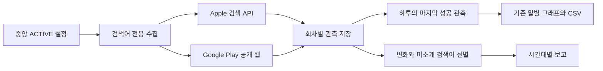

# 검색 순위 수집 확대와 Google Play 관측 설계 v1

- 상태: 사람 검토 대기. 구현, 운영 설정 변경, 알림 전송은 아직 하지 않았다.
- 기준: `fc99baa5b1fccef2f9ab3d26a8a8336c3bcb434c`, 조사 시각 2026-10-28 20:30 KST.
- 요청: 검색어 순위를 더 자주, 다양한 검색어로 보여주고 Google Play도 포함한다.
- 승인 대상: 이 설계와 같은 폴더의 `test-plan.json`. 승인 후 실행 이슈와 Ready PR에 연결한다.

## 제안과 보고 예시

| 항목 | 현재 확인 | 제안 |
| --- | --- | --- |
| 수집 | App Store, 매일 21:20 KST | 검색어 전용 수집을 07:20, 13:20, 20:20 KST에 실행 |
| 보고 | 매일 21:40 KST, 큰 변화 최대 3개 | 08:40, 14:40, 21:40 KST, 매회 최대 3개를 다른 검색어로 구성 |
| 추적 검색어 | 검색어가 있는 앱 13개, 앱당 2~9개 | 실제 기능에 맞는 장르와 구체적인 검색 표현을 앱당 최대 30개까지 보완 |
| Google Play | 검색 순위 수집 없음 | 공개 웹 검색 결과의 관측 순서를 별도 출처로 추가 |

다음은 표시 형식 예시이며 실제 측정값이 아니다. 기존 카드와 표의 배치는 유지한다.

```text
검색 위치 관측, 14:40
행복 농장, App Store, 미국, farm tycoon
이전 관측 34위 → 이번 28위

블룸핸드, Google Play 웹, 미국 설정 요청, poker roguelike
반환된 30개 목록에 없음, 14:12 관측

루시드 체스, App Store, 한국, 체스 힌트
18위 유지, 이번 회차에 소개한 검색어
```

큰 변화가 없는 경우에도 새로 소개할 검색어가 있으면 관측 요약을 보낸다. 순위 유지에 상승 의미를 붙이지 않는다. 이미 소개한 결과만 남으면 같은 내용을 다시 보내지 않는다.

## 확인한 근거와 한계

1. 운영 CronJob 조회에서 `backoffice-market-feedback`은 `20 12 * * *`, `backoffice-keyword-daily`는 `40 12 * * *` UTC이며 모두 활성 상태였다. 10월 27일 수집은 21:33:34 KST, 보고 작업은 21:40:11 KST에 성공했다. 작업 성공은 Discord 메시지 수신 확인과 구분한다.
2. 운영 DB를 읽기 전용으로 조회했다. ACTIVE 등록 행 29개 중 monitoring.enabled인 앱은 20개, 검색어가 있는 앱은 13개, 검색어가 빈 앱은 7개다. iOS 식별자가 있는 설정의 검색어와 국가 조합은 143개다. 이는 설정상 요청 수이며 실제 공개 앱 수나 성공 관측 수가 아니다.
3. `rank-report.ts`는 상위 10, 20, 50, 100개 경계 진입과 이탈, 상위권의 큰 변화 등을 고르고 최대 3개만 표시한다. 변화 중심 선별이 검색어 다양성을 제한한다.
4. `collector.ts`는 앱, 종류, 검색어, 국가, 날짜로 upsert한다. 같은 날 재수집하면 이전 값이 덮어써지므로 일정만 늘려서는 회차 간 비교가 보존되지 않는다. 보고도 날짜별 동일 메시지를 편집하는 구조다.
5. Google Play `farm tycoon`, `hl=en`, `gl=US` 공개 검색은 조사 중 HTTP 200이었고 앱 상세 링크 30개를 읽을 수 있었다. 광고 구분, 결과 순서, 페이지 추가 수집, 국가 적용은 검증하지 않았다. 이를 실제 30위 순위표로 간주하지 않는다.

## 수집과 데이터



- 평점, 지원 링크, 경쟁 앱과 공지 수집은 기존 하루 1회 일정을 유지한다. 검색어 수집만 분리하고 중복으로 실행하지 않는다. 승인 범위는 이 분리와 대체된 검색어 루프의 정리까지다.
- 회차별 검색 관측은 새 append-only 모델에 저장한다. 앱, 마켓, 출처, 요청 국가, 언어, 검색어, batch ID, source SHA, 설정 revision, 실제 관측 시각, 반환 개수, 순위와 상태를 기록한다. 같은 회차 재시도는 중복 저장과 중복 발송을 막는다.
- 상태는 관측됨, 반환 목록에 없음, 미수집, 실패, 해석 불가로 구분한다. 부분 응답이나 실패를 0위 또는 목록 밖으로 바꾸지 않는다.
- 기존 Apple 일별 `MarketObservation`과 읽기 경로는 유지한다. 새 Apple 관측 중 당일 마지막 성공값을 반영하고 실패로 지우지 않는다. 기존 이력은 삭제하거나 회차별 기록으로 만들어 채우지 않는다.
- Google Play는 마켓과 출처가 분리된 새 저장 경로를 쓴다. Apple 값과 섞거나 두 순위의 차이를 하나의 등락으로 계산하지 않는다. 기존 일별 조회에는 작은 마켓 선택과 출처 표기만 추가하고 시간별 그래프나 새 화면은 만들지 않는다.
- 보고의 비교 기준은 같은 앱, 마켓, 출처, 요청 국가, 언어와 검색어의 이전 성공 관측이다. 날짜와 시각, 반환 범위를 함께 표시한다. 첫 관측에는 상승이나 하락을 붙이지 않는다.

## 검색어와 보고 선별

- 기존 국가와 검색어는 보존한다. 현재 공개된 앱의 이름, 장르와 실제 기능 문구를 근거로 브랜드, 일반 장르, 구체적인 사용 목적의 검색어를 보완한다. 예: `farm tycoon`, `방치형 농장`, `poker roguelike`, `chess analysis`, `shared baby tracker`.
- 목표는 앱당 15~30개지만 관련 표현이 부족하면 수를 억지로 채우지 않는다. 공개 확인이 안 된 앱에는 신규 관측을 활성화하지 않는다. 새 국가, 스토어 문구와 제품 기능 변경은 범위 밖이다.
- 후보 생성과 설정 반영은 기존 control-plane validator와 서비스, 앱 범위 권한, revision 비교, 멱등성과 감사 기록을 사용한다. 기존 초안과 충돌하면 덮어쓰지 않고 해당 앱만 입력 필요로 남긴다.
- 각 회차는 확인된 큰 변화 최대 2개와 최근 7일간 가장 덜 소개한 검색어로 최대 3개를 채운다. 변화가 없으면 미소개 검색어로 구성한다. 후보가 충분하면 서로 다른 앱을 고르고 브랜드 검색은 최대 1개로 제한한다.
- 이미 보고한 같은 변화는 재사용하지 않는다. 현재 회차에 새 성공 관측이 없거나 새로 소개할 결과가 없으면 보고를 생략한다. 수집 실패 내역은 운영 기록에 남기고 사람용 순위 보고를 채우는 데 쓰지 않는다.
- 보고 식별자는 날짜와 시간대, 행 식별자는 앱, 마켓, 출처, 국가, 언어와 검색어다. 재실행은 같은 회차 메시지를 편집하고 다른 시간대 보고는 별도 메시지로 남긴다. 기존 일일 보고와 이중 발송하지 않는다.

## 공급자, 성능과 실패 처리

- Apple은 기존 최대 200개 응답, 8 MiB 검색 응답 한도, 15초 제한, 재시도와 최소 3.5초 요청 간격을 유지한다. 같은 국가와 검색어는 한 회차에서 한 번 조회해 여러 앱에 재사용한다. Apple 공식 문서는 분당 약 20회 한도와 캐시 사용을 안내한다.
- Google Play는 공개 웹 결과의 실제 순서와 본문 구조를 확인하는 파서를 사용한다. 추천 목록, 광고와 중복 앱을 일반 검색 결과에 섞지 않는다. 성공적인 빈 결과와 파서 실패를 구분한다. 반환 개수를 저장하며 목록에 없다는 사실을 정확한 다음 순위로 표현하지 않는다.
- Play는 기본 동시 요청 1개, 최소 5초 간격, 응답당 최대 8 MiB, 15초 제한, 일시적 실패에 최대 2회 재시도로 제한한다. 차단 화면이나 구조 변경은 실패로 남기며 로그인 우회나 프록시 구매를 하지 않는다.
- Play의 국가와 언어는 요청 조건이다. 국가별 결과 적용을 검증하기 전에는 `미국 설정 요청`처럼 표시하고 실제 미국 기기 순위라고 부르지 않는다. 자동 실행 전에 브랜드 검색, 일반 검색, 빈 결과, 광고 포함 결과를 구분하는 검증을 통과해야 한다. 실패하면 Play 활성화는 보류하고 사유를 남긴다.
- 수집은 65분 내에 끝내고 공급자별 요청 수와 제한 시간을 적용한다. 초과분은 미수집으로 남겨 다음 회차에 우선 배치한다. 보고는 완료된 현재 회차의 성공값만 사용하고 이전 회차 값을 새 관측처럼 표시하지 않는다.
- 공식 Play 유입 보고는 검색어별 방문, 설치와 전환율을 제공하지만 검색 결과 순위와 다른 데이터다. Cloud Storage 보고는 공식 안내상 3~7일 지연될 수 있다. 이 설계에는 신규 유입 수집기나 유료 분석 서비스 계약을 포함하지 않는다.

## 인수조건과 테스트

테스트 계획은 L1, 개발 환경이다. 기존 카드와 표를 유지하는 기능 확장으로 한정한다. 수집, 저장, 선별과 재시도는 요구 동작 때문에 실패하는 테스트를 먼저 확인한다. 외부 페이지와 운영 일정은 격리 실행, 원문 대조와 읽기 확인으로 검증한다.

| 조건 | 검증과 기대 결과 |
| --- | --- |
| AC-1 회차 보존 | 같은 날 3회와 같은 회차 재시도를 실행한다. 성공값 3개가 보존되고 재시도 중복은 없다. 일별 값은 마지막 성공값이다. |
| AC-2 마켓 분리 | 같은 검색어에 Apple 20위, Play 7위를 입력한다. 두 관측과 비교 기준, 반환 개수가 분리된다. |
| AC-3 다양성 | 서로 다른 앱의 성공 관측 12개와 브랜드 1위 반복을 넣는다. 최대 3개와 브랜드 1개 제한, 시간대별 새 검색어 선별을 확인한다. |
| AC-4 사실 구분 | 첫 관측, 목록 부재, 미수집, 공급자 실패, 광고와 추천 포함 원문, 잘린 응답과 구조 변경을 검사한다. 가짜 순위를 만들지 않는다. |
| AC-5 재실행 | 시간대별 별도 이벤트, 같은 시간대 편집, 같은 변화 재보고 억제를 확인한다. 격리 outbox를 사용하며 개발 검증에서 운영 채널로 전송하지 않는다. |
| AC-6 중앙 설정 | 기존 검색어와 다른 필드를 보존한 새 revision, 범위 권한, 경쟁 수정과 초안 충돌을 검사한다. 직접 Prisma 쓰기로 설정을 바꾸지 않는다. |
| AC-7 기존 조회 | 일별 그래프, 기존 이력, CSV, 375px 화면, 키보드 조작에서 마켓과 출처, 시각과 결측 표시를 확인한다. |
| AC-8 품질과 운영 | typecheck, lint, 더미 DB build와 관련 테스트를 통과한다. 중앙 before-deploy 검증 후 일정, 이미지 digest와 SHA를 읽어 확인한다. 배포 뒤 자연 실행 결과와 알림 공급자 수신을 각각 확인한다. |

기기 실행은 필요 없다. 파서와 개발 화면 검증으로 웹 관측 기능을 확인하며 실제 Play 앱 검색 순위 일치 검증을 통과했다고 기록하지 않는다. 제품 UI 구조를 개편하게 되면 현재 범위를 확장하지 않고 설계를 다시 검토한다.

## 적용, 복구와 승인

1. 설계와 테스트 계획을 승인받고 실행 이슈를 만든다. 기존 일별 이력과 설정을 보존한 채 추가 모델과 격리 검증부터 진행한다.
2. Play 파서 검증, 중앙 설정 후보 보완, 실제 개발 화면 확인과 품질 검사를 마친다. 승인 범위 안에서 Ready PR, 리뷰, 병합과 Backoffice 서비스 운영 반영까지 진행한다.
3. 운영 반영 전 중앙 검증기를 통과하고 기존 이미지, 일정과 활성 상태를 기록한다. 웹, worker와 두 CronJob의 적용 대상을 구분한다. 운영 알림은 승인된 자연 실행에 한정한다.
4. 복구는 이전 이미지와 하루 1회 일정으로 되돌린다. 새 관측 모델, 기존 이력과 설정 revision은 삭제하지 않는다. 설정 복구도 이전 값으로 새 revision을 만든다.

이 승인은 Backoffice 서비스와 기존 보고 채널의 정기 보고 확대에 한정한다. Google Play나 App Store의 앱 배포, 심사 제출, 가격, 계정과 credential 변경은 포함하지 않는다. 현재 승인, 구현과 배포는 모두 대기 상태다.

## 자료

- [Apple Search API](https://performance-partners.apple.com/search-api): 결과 제한, 호출 빈도와 캐시.
- [Google Play Android Publisher API](https://developers.google.com/android-publisher/api-ref/rest), [Reporting API](https://developers.google.com/play/developer/reporting/reference/rest): 공개된 메서드 목록에서 임의 검색어의 소비자 검색 순위를 제공하는 메서드를 확인하지 못했다.
- [Google Play 유입 보고](https://google.play/business/acquisitionreporting/), [공식 CSV 설명](https://support.google.com/googleplay/android-developer/answer/6135870?hl=en): 실제 유입 검색어, 방문과 설치, 소량 자료의 Other 처리와 데이터 지연.
- [google-play-scraper 원문](https://github.com/facundoolano/google-play-scraper): 공개 검색 수집 구현의 참고 자료다. 유지보수 중단과 파서 파손 가능성을 명시하므로 무검증 도입의 근거로 사용하지 않는다.
- 로컬 기준 파일: `src/lib/market/collector.ts`, `public-sources.ts`, `daily-ranks.ts`, `rank-report.ts`, `prisma/schema.prisma`, `k8s/market-feedback-cronjobs.yaml`.
