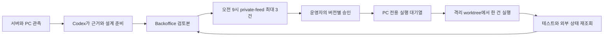

# 개인 대표 에이전트

승인 근거: 2026-10-30 대화에서 사용자가 제시한 「개인 대표 에이전트 구축과 운영 연결」 전체 계획과 구현 요청. 이 문서는 그 범위를 실행 가능한 계약으로 고정한다. 새로운 업무의 실제 승인은 제안별로 받는다.

## 구성과 상태

서버에는 WorkTarget, 시각과 출처를 가진 WorkObservation, 버전별 불변 본문을 가진 WorkProposal, 승인과 실행 이벤트를 보관한다. 실제 로컬 경로는 PC의 비공개 설정에만 둔다. 앱 대상은 최신 중앙 autonomous-issue-policy의 등록 대상과 제외 규칙을 읽는다. 도구, 공통 환경, 책과 집필 폴더는 존재와 Git 정본을 확인한 항목만 명시 등록한다.

관찰 모드에서는 제안을 내부 저장한다. 활성화 후 한국 시간 오전 9시 이후 하루 한 번, 최대 3건을 보낸다. PC가 잠들면 깨어난 뒤 처리한다. 분석은 하루 30분, 작업 시간은 승인 본문에 명시한다. 유효한 후보가 없으면 메시지를 보내지 않는다. 표본 부족, 오래된 자료, 관찰 대기, 제외, 진행 중인 동일 문제는 선별에서 제외한다. 등록과 처리 중인 기존 예약, 중앙 실행기의 잠금은 바꾸지 않는다.

제안 본문: 문제, 근거와 관측 시각, 영향과 기한, 신뢰도, 범위, 설계, 완료 조건, 테스트 계획, 도구, 시간 상한, 출시 범위, 원본 고정, 검토본. 코드의 설계와 test-plan.json은 같은 로컬 Git 커밋에 존재하고 실행 후보의 조상으로 유지한다. 문서는 승인한 상대 경로별 SHA-256과 변경 미리보기를 적용 직전 대조한다. 본문 수정은 새 버전이며 오래된 버튼은 거부한다.

버튼은 진행, 7일 보류, 제외, 상세 보기다. Slack 서명, workspace, application, private-feed, 운영자 ID를 확인하며 웹은 지정 운영자의 로그인과 같은 출처 요청을 확인한다. 모델용 토큰으로 승인할 수 없다. 승인자, 버전, 본문 해시, 시각을 보존한다. 같은 버전의 진행은 실행을 하나만 만든다.

OperatorCommandRun에 실행 위치, 소유자, lease 만료, 세대, 체크포인트를 추가한다. 기존 서버의 claim과 유지보수는 SERVER만 조회한다. PC는 전역 한 건의 변경 잠금을 트랜잭션으로 잡는다. lease 만료는 불명 상태로 남기며 자동 재claim하지 않는다. PC는 heartbeat 실패 시 자식 프로세스 그룹을 종료한다. 재부팅이나 응답 유실 후 정확한 CLI 세션 ID, 파일과 provider 상태를 조회하고, 쓰기 결과가 불명확하면 보류한다. 취소 후 늦은 성공 보고는 거부하고 중단 확인만 받는다. 중단 결과와 근거가 확인돼야 잠금을 푼다. CLI 한도, 권한 거절에는 대기하며 다른 계정이나 유료 API로 전환하지 않는다. 자동 재시도 상한은 1회이고 쓰기 결과 불명에는 적용하지 않는다.

로컬 실행기는 Backoffice에서 배포하는 Python 표준 라이브러리 실행기와 사용자 LaunchAgent다. 기존 shared/backoffice/operator 자격증명을 실행 프로세스에서 직접 읽고 CLI 인자나 모델 환경에 전달하지 않는다. Codex CLI JSON 이벤트에서 정확한 thread_id만 보존하며 --last를 사용하지 않는다. 실행 상태 정본은 서버다. 재전송 파일과 세션 식별자 외 원고나 대화 전체를 상시 서버 복제하지 않는다. MiniMax 리뷰와 Seorilabs 개발 정책은 유지한다.

## 인수조건

- AC1 대상 정책과 근거의 신선도, 표본, 관찰 대기, 중복, 제외, 후보 없음, 집필 관측을 선별한다.
- AC2 사람만 정확한 제안 버전을 승인하며 Slack 위조, 다른 사용자와 채널, 중복과 오래된 버튼, 변경된 원본을 거부한다.
- AC3 서버 worker와 PC 작업을 분리하며 동시 claim, 만료, 재부팅, 단절, 응답 유실, 취소 후 늦은 완료에서 중복 실행과 이력 삭제를 막는다.
- AC4 코드 설계 커밋과 문서 해시, 시간과 출시 범위를 실행에 결합하고 결과 근거 없는 완료를 거부한다.
- AC5 웹 검토본은 근거, 설계, 테스트와 변경 미리보기, 진행과 결과를 작은 화면에서도 확인할 수 있다.
- AC6 기존 명령, 배포 승인, 알림, 앱 접근과 중앙 실행 잠금을 보존한다.
- AC7 개발 검증, 독립 검수 3회, 중앙 검증, Ready 전 MiniMax 리뷰 후 병합과 배포, LaunchAgent 설치, 관찰과 발송 활성화를 구분한다.

## 검증과 적용

L3, 개발 환경 전체 회귀, 독립 기능과 UX 검수 3회. 실제 기기는 사용하지 않는다. 서비스 API와 MySQL 격리 데이터, 실제 Next 개발 화면과 작은 화면, fake CLI와 실제 읽기 전용 CLI 경계를 사용한다. 승인 쓰기와 실행 복구는 먼저 실패 테스트를 만들고 구현한다. LaunchAgent와 배포 설치 자체는 정적 검사와 실제 상태 재조회로 검증한다.

추가형 마이그레이션만 적용한다. 신규 관측과 claim을 중지하면 롤백되며 이미 승인된 이력과 실행 체크포인트는 보존한다. 전체 배포는 기존 immutable image와 마이그레이션 검증 절차를 따른다. 관찰 모드, Slack 활성화, 최초 자연 관측, 실제 사용자 승인, 승인 실행, 완료 근거는 각각 보고한다. 실제 첫 작업 승인 없이 전체 운영 완료로 표시하지 않는다.
