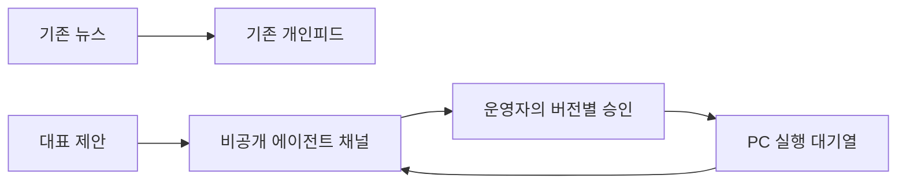

# 대표 에이전트 전용 Slack 채널

사용자는 기존 개인피드가 뉴스 채널임을 확인하고 `1번이고 #에이전트`라고 별도 비공개 채널을 지정했다. 이 지시를 반영한 최소 변경이며 기존 대표 에이전트 설계와 IAP 복구 수정, 테스트 깊이와 배포 끝 지점은 유지한다.

## 대상과 흐름

실제 Slack에서 `#에이전트`, `C0CDN5X6Z7E`를 확인했다. workspace는 `T0CCP49NJAK`이고 비공개이며 운영자 `U0CD2GKL36J`와 기존 봇 `U0CD4EU0Y4S` 두 명만 참여한다. 기존 봇의 권한과 자격증명을 변경하거나 채널을 중복 생성하지 않았다.

기존 `private-feed` 목적지와 `SLACK_CHANNEL_PRIVATE_FEED_ID`는 유지한다. 대표 에이전트에는 논리 목적지 `supervisor`와 공개 설정 `SLACK_CHANNEL_SUPERVISOR_ID`를 사용한다. 다음 네 경로를 같은 새 목적지에 결합한다.

- 제안 메시지 발송
- 승인 버튼의 workspace, 채널과 운영자 검증
- 승인 실행의 channelId 기록
- 작업 완료와 확인 필요 결과 알림

새 채널 설정이 없으면 뉴스 채널로 대신 보내지 않는다. 제안 예약과 승인 실행 생성 전에 설정을 확인하고, 결과 전송도 기존 전송기의 미설정 처리를 사용한다. 웹과 notification worker에 공개 채널 ID를 설정하며 기존 Secret과 뉴스 채널은 수정하지 않는다. 모델 토큰으로 승인하거나 기존 중앙 실행기 권한을 확대하지 않는다.

## 검증과 운영

기존 뉴스 채널이 설정되어 있어도 대표 채널이 없으면 대표 발송과 승인을 거부하는 실패 테스트를 먼저 확인한다. 대표 채널의 승인만 허용하고 뉴스 채널의 같은 버튼은 거부한다. 승인 run과 완료 outbox가 새 목적지를 사용하며 일반 뉴스 목적지는 유지되는지 실제 개발 환경에서 검증한다. 사용자에게 운영 제안을 보내는 것은 관찰과 운영 연결을 확인한 뒤다.

최종 후보가 바뀌므로 이전 1~8회의 실제 SHA, 시각, 원본과 판정을 보존하며 새 후보의 UI 합격 수에 소급하지 않는다. 이미 승인한 9, 10회는 채널 변경을 반영한 같은 새 후보에서 수행한다. 새 후보의 완전한 독립 검수 최소 3회가 부족하면 현재 승인 상한 10에서 보고하고 추가 승인 전 정지한다. 11회 승인을 이 채널 지시에서 만들어내지 않는다. 실제 기기와 유료 API는 사용하지 않는다.

배포, PC 실행기 설치, 관찰과 초기 활성화는 원래 승인한 끝 지점까지 이어간다. 자연 관측에서 나온 개별 작업은 실제 사용자 승인을 별도로 받는다. 운영 실패 시 새 대표 발송과 claim을 중지하고 실행과 승인 이력을 보존한다. 기존 뉴스 운영은 유지한다.
