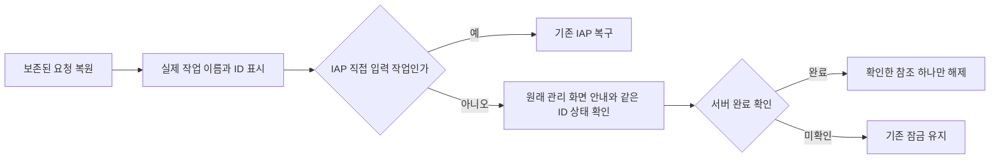

# 플랫폼 복구 작업 표시 수정과 대표 에이전트 검수 재개안

상태는 검토 요청이며 구현과 새 검수는 시작하지 않았다. 대표 에이전트 원래 설계 커밋 `005dcba97b0f179f5e13319198c395074e1e6d33`과 운영 끝 지점은 유지한다. 현재 구현은 [PR #559](https://github.com/seorilabs/seorilabs-backoffice/pull/559)의 `66269955d731ee017a53b7b237e2aaf97b29f8b8`이다.

## 관찰과 영향

추가 UI 5회에서 광고 차단 회수 요청 `dfd41965-cdbf-44cd-9c7a-25403362b676`을 IAP 화면이 `App Store Sandbox 원장 초기화`, `결과 미확인`으로 표시했다. 실제 SQL은 광고 회수 `SUCCEEDED`, provider 적용은 1건이고 Sandbox 초기화는 0건이다. 남은 공통 복구 참조를 IAP가 읽는 경로와 작업 라벨의 기본 분기가 원인이다. 해당 소스는 기존 기본 브랜치와 같아 이번 대표 에이전트 구현의 변경 파일은 아니다.

검수 도구도 정확한 요청의 클라이언트 완료 대신 과거 광고 회수 성공 행을 허용해 화면을 일찍 이동했다. 제품 오표시와 도구 문제를 구분한다. 5회는 24개 완료, 1개 미완료로 보존하고 완전 검수에 세지 않는다. 6회는 아직 계획하거나 실행하지 않았다.

원본 진단은 NAS의 `seorilabs-backoffice/2026-10-30/66269955d731ee017a53b7b237e2aaf97b29f8b8/platform-round5-readonly-diagnosis-20261030T075552Z`에 있다. 검증 manifest SHA-256은 `2fc434ba08d0b4169ddedab54b5f59e610f6104790dffd97ff7711f634ae9665`다. 4, 5회 원본은 독립 검수자가 별도로 보존한다.

## 제안하는 최소 수정

공통 복구 참조와 기존 서버 잠금은 유지한다. 다른 종류의 작업을 IAP 작업으로 바꾸거나 참조를 임의로 지우지 않는다.

1. 지원하는 플랫폼 작업 모두에 실제 이름을 대응시킨다. 광고, 우편과 시험 계정 작업을 Sandbox 초기화로 표시하는 기본 분기를 제거한다.
2. IAP 지급, 회수와 Sandbox 초기화만 IAP 입력 선택값으로 복원한다. 다른 작업 참조는 실제 이름, 보존된 ID와 원래 관리 화면 안내로 표시하고, IAP 화면에서 다른 종류의 작업을 재등록하거나 재실행하지 못하게 한다. 기존 환불 검토 흐름은 보존한다.
3. 같은 ID 상태 조회로 서버의 확정 결과를 읽었을 때만 해당 로컬 참조를 해제하는 기존 동작을 유지한다. 결과 미확인 상태에서는 새로운 작업을 열지 않는다. 저장소 오류, 앱 권한과 서버 잠금 검사를 유지한다.
4. 검수 도구는 현재 요청 ID의 서버 및 provider 결과와 클라이언트 완료를 각각 확인한 뒤 이동한다. 결함 재현 경로에서는 일부러 광고 복구 참조를 남기고 IAP 진입, 정확한 안내와 같은 ID 조회, 중복 실행 없음까지 확인한다.

변경은 IAP 복구 표시, 작업 분류와 관련 회귀 테스트에 한정한다. DB 마이그레이션, 플랫폼 API 계약, 결제 상품과 가격, 사용자 원장 삭제, 기존 중앙 실행기 권한을 바꾸지 않는다. 실제 기기와 유료 API를 사용하지 않는다.

## 테스트와 완료 조건

같은 폴더의 `test-plan.json`은 L3 개발 환경 전체 회귀다. 작업 이름과 입력 복원 및 외부 작업의 재실행 차단을 먼저 실패 테스트로 고정한다. 광고 성공 직후 이동, 결과 미확인, 참조 여러 개, 저장소 오류, 실제 IAP 지급과 회수를 확인한다. 모든 요청 ID를 SQL과 대역 provider에 결합하고 새 Sandbox 초기화가 0건인지 확인한다. 코드 품질, 전체 테스트, 기존 CI와 중앙 검증기도 유지한다.

수정으로 후보 SHA가 바뀌므로 이전 1~5회의 실제 SHA, 시각, 실패와 미완료 및 원본 해시를 과거 기록에 보존하고 새 후보 합격 수에 세지 않는다. 새 후보를 고정한 뒤 실제 6, 7, 8회를 순서대로 계획하고 UI 기능 25개, 오류 복구, 작은 화면과 글자 확대를 독립 검수한다. 서비스 23개도 새 후보에서 독립 실행한다. 검수 도중 소스가 다시 바뀌거나 8회 뒤에도 조건이 남으면 추가 승인 전 정지한다. 반복 확인으로 회차 상한을 우회하지 않는다.

## 승인 요청

위 최소 수정과 같은 후보의 독립 UI 6~8회, 서비스 전체 회귀를 요청한다. 예상 90~120분이며 기존 무료 CLI와 개발 환경을 사용한다. MiniMax 리뷰는 이미 사용한 PR 회차와 재시도 상한을 넘기지 않고 추가 변경을 자체 점검한다. 중앙 기록 형식은 [PR #316](https://github.com/seorilabs/.github/pull/316)으로 병합됐으며 이 제안에서는 다시 변경하지 않는다.

승인되면 설계와 테스트 계획을 고정한 이 커밋의 자손에서 구현하고 원래 계획의 PR 병합, 배포, PC 실행기 설치와 관찰 모드를 이어간다. 자연 관측으로 나온 실제 작업 제안의 승인은 별도로 사용자에게 받는다. 승인 전에는 구현, 새 UI 회차, 이미지 배포와 실행기 설치를 진행하지 않는다. 기존 서비스는 유지된다.
