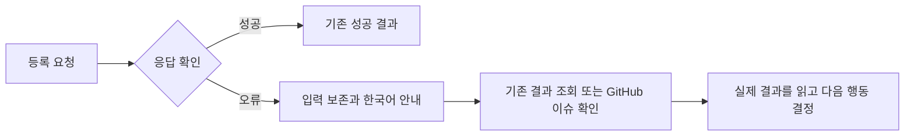

# 대표 에이전트 통합 검수에서 발견한 등록 오류 안내 수정안

상태는 승인 대기다. 이 변경은 설계와 테스트 계획만 작성했으며 제품 코드는 수정하지 않았다. 기준은 최신 기본 브랜치 `d74b632`를 보존한 통합 코드 `2d570384bd4fd5bb29ddbb21c6a86c9ef2344e33`이다.

## 문제와 근거

독립 UI11에서 AI 초안의 GitHub 등록과 기획 이슈 등록이 거절됐을 때 화면에 `Minified React error #441`와 개발 문서 주소가 표시됐다. 입력 내용은 보존됐지만 운영자가 처리 상태와 안전한 다음 행동을 이해하기 어려워 UX 실패로 판정했다. 제품 코드를 바꾸지 않고 문구 검색 조건만 바꾸는 것으로 해결하지 않는다.

같은 초안 복구 화면의 320px와 글자 200% 원본에서 결과 조회 버튼 오른쪽이 378.42px에 있어 화면을 58.42px 벗어났고 폐기 버튼은 화면 밖에 있었다. 문서 전체 너비는 320px여서 문서 너비 비교만으로는 발견하지 못했다. 실제 버튼 경계와 화면을 확인했다.

실행 원본은 NAS의 `seorilabs-backoffice/2026-10-31/2d570384bd4fd5bb29ddbb21c6a86c9ef2344e33/independent-ui-round11-20261031T013628Z`에 보관했다. 원자동화는 22개 통과와 3개 차단으로 종료됐고 SHA-256은 `46e3f3ffccb529f4f09fed1b1636ba3ecd61199525cf66bd6cf53b02fdf0f376`이다. 출시노트 차단은 검수 도구의 준비 대기와 행 선택 오류였으며 제품 수정 대상은 아니다.

- [초안의 기술 오류 노출](</Volumes/Data/Backup/agent-artifacts/seorilabs-backoffice/2026-10-31/2d570384bd4fd5bb29ddbb21c6a86c9ef2344e33/independent-ui-round11-20261031T013628Z/round-11/036-local-draft-editor-failure.png>)
- [작은 화면의 복구 버튼 잘림](</Volumes/Data/Backup/agent-artifacts/seorilabs-backoffice/2026-10-31/2d570384bd4fd5bb29ddbb21c6a86c9ef2344e33/independent-ui-round11-20261031T013628Z/round-11/037-compact-local-draft-editor.png>)
- [기획 등록의 기술 오류 노출](</Volumes/Data/Backup/agent-artifacts/seorilabs-backoffice/2026-10-31/2d570384bd4fd5bb29ddbb21c6a86c9ef2344e33/independent-ui-round11-20261031T013628Z/round-11/042-issues-planning-and-stage-transitions-failure.png>)
- [독립 검수 보고서](</Volumes/Data/Backup/agent-artifacts/seorilabs-backoffice/2026-10-31/2d570384bd4fd5bb29ddbb21c6a86c9ef2344e33/independent-ui-round11-20261031T013628Z/round-11/report.md>)

11회 최종 판정 시각은 `2026-10-31T01:33:37.813448Z`다. 원본 결과 JSON의 SHA-256은 `e0322e40119c679bdfce4be2e58fb79595a8326cc6b84b9bc04cd2562af3aafe`, 보고서는 `081b93b1fb4427b22cdd8c215ea4288375a4730c2a3af40df52c7cbb4fe8c4b1`이다. NAS 446개 파일과 20,457,182bytes를 직접 읽어 검증했으며 최종 manifest SHA-256은 `ac4f7d76a7f0723191090beb91f597f4af4b3dfc30874222e006d8ef3106fc49`다. 검증을 마친 원시 자료의 로컬 복사본은 정리했다.

허용된 보충은 검수 도구가 실제로 없는 `App.lifecycle` 필드를 조회해 첫 읽기 단계에서 멈췄다. 실행 1.665초와 정리 0.067초였고 정상 등록, 기획, 출시노트와 단계 변경 쓰기는 0건이다. 정적 감사도 이 필드 계약 오류를 놓쳤다. 추가 보충하지 않으며 11회는 22개 완료와 3개 미완료, UX 실패와 완전 검수 인정 0회로 보존한다.

React의 배포 빌드는 서버 오류 원문을 숨긴다. [공식 오류 설명](https://react.dev/errors/441)과 실제 화면을 대조했다. 앱은 이 기술적 오류 문자열을 그대로 화면에 출력하고 있다.

## 화면과 상태

| 상황 | 현재 표시 | 변경할 표시와 행동 |
| --- | --- | --- |
| AI 초안 등록 응답 오류 | 영문 내부 오류 코드와 개발 문서 주소 | 등록 결과를 확인하지 못했다고 알리고, 중복 등록을 막기 위해 다시 보내지 않으며 `GitHub 등록 결과 확인`을 안내한다. |
| AI 초안 결과 조회 응답 오류 | 오류 원문 | 초안을 보존했고 결과를 아직 확인하지 못했다고 알리고, 잠시 후 같은 결과 조회를 다시 하도록 안내한다. |
| 기획 이슈 등록 응답 오류 | 영문 내부 오류 코드와 개발 문서 주소 | 결과를 확인하지 못했고 입력을 보존했다고 알린다. 선택한 저장소의 `GitHub 이슈 확인` 링크를 제공해 먼저 실제 생성 여부를 확인하도록 안내한다. |
| 초안 복구 상태의 작은 화면 | 결과 조회 버튼 일부와 폐기 버튼이 화면 밖에 배치됨 | 버튼 행을 줄바꿈해 각 버튼을 읽고 키보드와 포인터로 사용할 수 있게 한다. |

오류만으로 거절, 미등록이나 성공을 단정하지 않는다. 결과를 확인하기 전에 재등록을 권하지 않는다. 자동 재전송을 추가하지 않는다.

## 변경 범위와 구조

- `src/components/AiAgentPanel.tsx`의 등록과 결과 조회 `catch` 두 곳에서 오류 원문 대신 상황에 맞는 한국어 안내를 표시한다.
- 같은 컴포넌트의 복구 버튼 행에 줄바꿈을 적용한다. 버튼의 실제 경계가 화면 안에 들어오는지 확인한다.
- `src/components/PlanForm.tsx`의 등록 `catch`에서 한국어 안내를 표시하고 오류 상태일 때 선택한 저장소의 GitHub 이슈 목록 링크를 제공한다.
- 서버 작업, 등록 상태, 권한, 중복 방지, 데이터베이스, 공급자 호출과 실행 대기열은 기존 서비스를 사용한다. 새 공통 계층이나 호환 코드를 만들지 않는다.

오류 원문을 그대로 보존하는 대안은 운영자에게 다음 행동을 설명하지 못한다. 서버 액션 전체를 구조화된 결과 형식으로 바꾸는 대안은 이번 문구 문제보다 영향 범위가 커서 선택하지 않는다. 사용자 화면의 기술 오류 노출을 두 화면의 해당 처리에서 고친다.

## 인수조건과 테스트

| 조건 | 실제 개발 환경 확인 |
| --- | --- |
| RE1 초안 등록 오류 안내 | 배포 형태에서 거절과 응답 유실을 재현한다. 한국어 안내, 제목과 본문 보존, 기존 등록 잠금과 결과 조회를 확인한다. 오류 코드와 개발 문서 주소를 사용자 안내로 표시하지 않는다. |
| RE2 조회 오류 안내 | 같은 요청의 읽기 응답 실패를 한 번 재현한다. 쓰기 재전송 없이 조회 안내와 초안 보존을 확인하고 같은 결과를 다시 읽는다. |
| RE3 기획 등록 오류 안내 | 공급자 거절과 응답 유실을 구분해 확인한다. 입력 보존, 선택한 저장소의 정확한 GitHub 링크, 자동 재전송 0건을 확인한다. |
| RE4 회귀와 원본 보존 | 같은 최종 코드에서 UI25개 기능 전체와 UX를 독립 3회, 서비스23개 전체를 독립 실행한다. 이전 1~11회 실패, 차단, 보충과 원본 해시는 유지한다. |
| RE5 작은 화면의 복구 행동 | 320px와 글자 200%에서 등록, 결과 조회와 폐기 버튼의 실제 경계, 문구와 키보드 접근을 확인한다. 각 버튼을 화면 안에서 사용할 수 있어야 하며, 문서 전체 너비 비교만으로 통과시키지 않는다. |

등급은 L3, 개발 환경 전체 회귀이며 실제 기기는 쓰지 않는다. 작은 화면 320px와 글자 200%, 키보드와 복구 행동을 실제로 실행하고 PNG를 읽는다. 단순 문구 상수를 그대로 비교하는 단위 테스트로 대신하지 않는다. 기존 UI11의 실제 오류 화면을 실패 근거로, 수정 뒤 동일 흐름의 실제 화면과 요청 읽기를 통과 근거로 사용한다.

독립 검수 12, 13, 14회를 새 최종 코드에서 순서대로 계획하고 실행한다. 이전 코드의 12, 13회 승인은 미사용으로 보존하고 새 코드의 사전 승인으로 소급하지 않는다. 회차 계획 전에 도구 구문, 이름, 요청 ID와 종료 상한을 독립 검수자가 확인한다. 모든 Prisma 조회의 모델, 필드와 호출 인자를 현재 스키마 및 실제 개발 DB의 읽기 준비 검사와 대조한다. 구문 검사와 도구 자체의 순수 검사만으로 준비 완료를 판정하지 않는다. 초안 거절에 사용한 provider 모드는 반드시 정리하고 실제 상태를 읽으며, 출시노트는 준비 완료와 정확한 버전의 행을 기다린다. 기능별 보충은 한 차례만 허용하고 완료한 쓰기는 반복하지 않는다.

세 회차가 끝나면 최신 중앙의 service와 web 빌드 전, 배포 전 네 검사를 모두 통과해야 한다. 같은 최종 코드의 서비스 전체 회귀와 필수 품질 검사도 수행한다. MiniMax 리뷰는 이 PR에서 사용한 두 회차 상한을 유지하고 추가로 실행하지 않는다. 이번 최소 변경은 직접 점검과 독립 실행으로 확인한다.

## 적용, 승인과 정지

요청 범위는 위 두 화면의 등록 오류 안내와 초안 복구 버튼 줄바꿈 최소 수정, 새 최종 코드의 UI12~14와 서비스 전체 회귀다. 예상 60~90분이며 기존 무료 로컬 도구와 CLI를 사용한다. 유료 API, 다른 계정과 실제 기기는 사용하지 않는다.

승인되면 이 설계와 같은 커밋의 `test-plan.json`을 조상으로 유지하며 구현한다. 통과 뒤에는 이미 승인한 PR 병합, 검수한 코드의 Backoffice 배포, PC 실행기 설치, 관찰과 초기 활성화를 이어간다. 첫 자연 작업의 실행은 실제 제안 버전에 대한 사용자 버튼 승인 뒤에 수행한다.

승인 전에는 제품 코드를 수정하거나 UI12를 시작하지 않는다. 새 최종 코드가 검수 중 바뀌거나 14회 뒤 미충족 조건이 남으면 다음 회차를 시작하지 않고 결과를 보고한다. 배포 전 정지 시 기존 운영 서비스와 뉴스 개인피드, 승인 및 실행 이력을 보존한다. 되돌릴 때는 신규 관찰과 claim을 멈추고 체크포인트와 이력을 보존하는 기존 운영 절차를 따른다.
