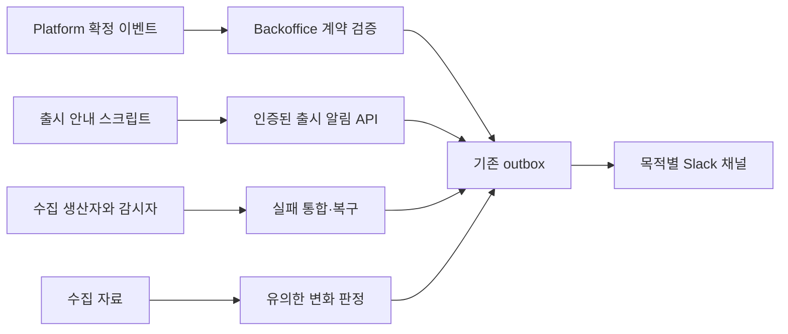

# 슬랙 알림·보고 정리

사용자가 전달한 「슬랙 알림·보고 정리」 계획을 구현 정본으로 채택했다. 2026-11-13의 구현 지시는 검증, Ready PR, 병합, 운영 반영과 슬랙 수신 확인까지 승인한다. 과거 메시지의 일괄 수정·재발송은 하지 않는다.

결제알림은 마켓, 실제·테스트·미확인, 앱, 지급항목, 지급 원장 사용자 ID와 검증된 결제 국가를 표시한다. 복원·이전은 신규 결제와 구분한다. 광고보상은 저장된 clientPlatform, 앱, 항목·수량을 표시한다. 앱이벤트의 원본 국가만 표시하며 언어·통화·IP로 국가를 추정하지 않는다.

출시 안내는 기존 운영 인증과 outbox를 쓰는 `/api/admin/release-notifications`로 통합한다. 발송 ID로 멱등 처리하고 접수와 전달 상태를 구분한다. 스크립트의 Discord 직접 발송은 종료한다.

수집 성공·성공 건수 요약은 발송하지 않는다. 실패·누락·권한 문제는 수집결과에 대상·실패 항목·기간·원인·조치·상세 링크를 보내고 동일 실패와 감시자 중복을 합친다. 보고된 실패가 해결됐을 때만 복구를 알린다. 실제 사용자 피해의 장애 경로는 유지한다.

순위보고 일정·국가·검색어는 유지한다. 본문은 결론, 변화 최대 두 줄, 상세 링크이며 PNG는 유용한 도표 최대 두 장이다. 목록 밖 유지 항목을 앱별로 나열하지 않고 미수집을 목록 밖으로 그리지 않는다. 카테고리와 검색 위치를 구분한다.

지표보고는 기존 봇과 채널 C0CHG2BUX17, 새 목적지 metric-insights를 사용한다. 수집 후·일일·정정·실시간·주간 지표를 옮기고 재무보고는 금액 중심으로 유지한다. 매 수집 후 분석하되 기존 표본·절대 변화·변화율 기준을 충족하는 새 변화만 발송한다. 매일 11시에 최대 여섯 핵심 수치와 비교값, 7일 추세·앱 비교 및 최대 세 인사이트를 보낸다. 출처·기준일·리스팅을 구분하고 누락은 0으로 만들지 않는다. AI 실패에도 근거가 있는 해석만 보내며 수치 나열만 발송하지 않는다.

검증은 L1·서비스 개발 환경이다. 국가·ID 유무, 실제·테스트·미확인, 복원·이전, Android·iOS, 성공 무발송, 부분 실패·중복·복구, 인사이트 반복 억제, 목록 밖·미수집·자료 부족·AI 실패를 회귀 테스트한다. 고정 자료 PNG를 렌더링해 가독성과 잘림을 확인한다. Backoffice 전체 테스트·typecheck·lint·웹/worker 빌드, Platform Go 테스트·vet·lint, 출시 스크립트 테스트와 중앙 검증을 실행한다. 실제 결제·기기는 사용하지 않는다.

수신 계약·채널 연결, Platform 이벤트, 출시 스크립트 순으로 적용한다. 이전 이미지·설정·스크립트를 복구 기준으로 남긴다. 수집·결제·발송 원장은 보존한다. 테스트 표시 메시지와 다음 자연 실행은 구분해 확인한다. 원본 증적은 NAS1dual에 크기·해시 검증 후 이관한다.

실행 이슈: [#580](https://github.com/seorilabs/seorilabs-backoffice/issues/580).
