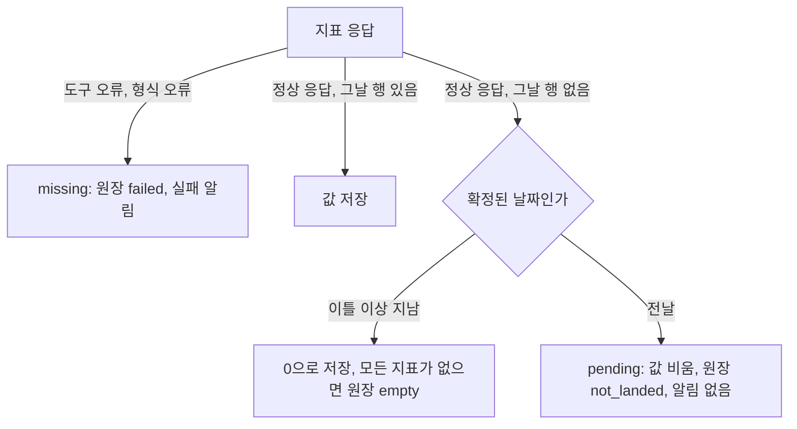

# 앱인토스 콘솔 수집의 활동 0과 실패 구분

2026-11-17 사용자가 "AppsInToss 콘솔 수집이 날마다 7~9건 실패한다"는 보고에 "왜 자꾸 실패해? 실패원인 확인하고 고치자"로 수정을 지시했다. 승인 범위는 원인 수정, 검증, Ready PR, 병합, 운영 배포, 그리고 과거 실패 기록을 바로잡는 일회성 재조회다.

## 원인

예약 수집(`backoffice-ait-console-metrics`, 하루 4회)은 날짜마다 광고(Android, iOS)와 결제 응답에 그날 행이 있는지 본다. 행이 없으면 "미확인 지표"로 보고 원장(`metric_collection_ledger`)에 `failed`를 쓰고 실패 알림을 만든다.

그런데 콘솔은 활동이 없는 날의 행을 응답에서 뺀다. 2026-11-17에 콘솔을 직접 조회한 결과는 다음과 같다.

- happy-farm(31877) Android 광고 11/10~16: 행은 11/11, 11/12 두 날만 있다. 같은 기간 iOS는 7일 모두 노출 0으로 행이 있다.
- babycare(54868) 11/10~16: 사용자, 결제 응답이 모두 빈 배열이다. 활동이 없는 리스팅이다.

그래서 정상 응답의 행 부재까지 실패로 쌓였다. 10/08 이후 날마다 10개 리스팅 중 7~10개가 `failed`이고, 7월부터 누적 586칸이다. 같은 칸을 14일 동안 하루 4번 다시 조회해도 결과가 바뀌지 않았다(관측 24회). 집계 지연이 아니라 활동 0이라는 근거다.

반대로 집계 지연도 실제로 있다. crossword-puzzle(56407)의 11/15 칸은 11/16 03:30 회차에 일부 지표가 없었고 09:30 회차부터 채워졌다(관측 8회 중 상태 변경 1회). 같은 날 15:30과 21:30 회차의 전날 결과는 같았다.

## 동작

1. `normalizeConsoleResponses`는 `settledThrough`(기본값: 조회 끝 날짜의 전날) 이전 날짜에 한해, 정상 응답의 광고, 결제 행 부재를 0으로 채운다. 일별 합계 행이 없으면 OS 행의 합을 쓰고 OS 행도 없으면 0이다.
2. `missing`은 응답 자체가 실패했거나 형식이 맞지 않는 지표만 담는다. 원장 `failed`와 실패 알림은 이것만으로 만든다.
3. 전날의 행 부재는 `pending`으로 돌려준다. 저장 행에는 `raw.pendingMetrics`로 남기고 원장은 `not_landed`(집계 대기)로 쓴다. 다음 회차가 같은 날짜를 다시 조회하고, 다음 날에는 확정된 날짜로 바뀐다.
4. 확정된 날짜에서 모든 응답이 정상이고 어떤 지표 행도 없으면 `emptyDates`로 돌려준다. 예약 수집은 그 날짜에 저장 행이 없을 때만 원장에 `empty`를 쓴다. `observed` 칸은 덮지 않는다. 직접 push 경로는 받은 행만 저장하므로 지금처럼 `empty`를 쓰지 않는다.
5. 콘솔 `empty` 칸도 `observed`와 같은 규칙(3일 경과)으로 봉인한다. 활동 없는 리스팅이 보고서의 as-of 판정을 계속 잠정으로 묶지 않는다.
6. 예약 수집의 재조회 하한은 최근 14일이다. 운영자가 `AIT_CONSOLE_RETRY_FROM=YYYY-MM-DD`를 준 일회성 실행만 그 날짜부터 남은 실패 칸을 다시 조회한다. 배포 뒤 이 값을 `2026-07-01`로 한 번 실행해 과거 586칸을 다시 판정한다.

## 바뀌지 않는 것

- DAU와 신규 사용자 행 부재는 지금처럼 `null`(콘솔 미집계)이다. 로그인하지 않은 세션이 있는 날 콘솔이 DAU를 빼는 경우가 있어 0으로 만들지 않는다.
- 저장은 값이 있는 필드만 갱신한다. 0으로 채운 값도 다음 회차의 실제 값으로 덮인다.
- 수집 결과의 `partial` 상태는 지금처럼 보존하며 알림을 만들지 않는다.

## 대안

| 안 | 판단 |
| --- | --- |
| 모든 행 부재를 0으로 확정 | 기각. 새벽 회차의 전날 집계 지연이 실측됐다. 지표 인사이트가 전날 0을 하락으로 보고할 수 있다. |
| 실패 알림에서만 빼고 원장은 그대로 | 기각. 원장 `failed`가 보고서 as-of 판정을 영구 잠정으로 만들고 날마다 같은 칸을 다시 조회한다. |
| 리스팅을 수집 대상에서 제외 | 기각. 활동이 다시 생기면 놓친다. 조회 비용이 차이 나지 않는다. |

## 검증 (L1, 개발 환경)

- 단위: 응답 해석(확정, 전날, 오류, 전부 빈 날), 봉인 규칙, 수집 CLI의 성공 종료와 부분 완료 보존, 실제 HTTP MCP 가짜 서버 연동.
- 격리 MySQL 인수 시험(`scripts/test-console-metrics.ts`): 활동 없는 기간을 수집해 값 없는 실패 칸이 `empty`로 바뀌고, 값이 저장된 칸과 `observed` 칸은 유지되며, 전날은 `not_landed`인지 확인한다.
- 전체 `pnpm test`, typecheck, lint, build와 CI.
- 운영: 배포 뒤 일회성 재조회 1회와 다음 예약 회차에서 원장 `failed` 감소와 실패 알림 부재를 확인한다.

## 인수조건

- AC1 정상 응답의 행 부재는 확정된 날짜에서 0, 전날에서 집계 대기로 처리하고 `missing`에 넣지 않는다.
- AC2 응답 오류와 형식 오류는 지금처럼 `missing`, 원장 `failed`, 실패 알림으로 남는다.
- AC3 확정된 날짜의 활동 없는 칸은 원장 `empty`이고, 저장 행이 있거나 `observed`인 칸은 바꾸지 않는다.
- AC4 전날의 집계 대기는 원장 `not_landed`이며 실패 알림을 만들지 않는다.
- AC5 `AIT_CONSOLE_RETRY_FROM`이 있을 때만 14일보다 오래된 미확인 칸을 다시 조회한다.
- AC6 운영 배포 뒤 재조회와 예약 회차에서 응답 오류가 없는 리스팅의 새 `failed` 칸이 0이다.
