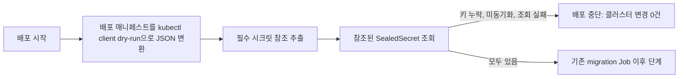

# 배포 전 필수 시크릿 키 확인

2026-11-17 사용자가 장애 보고에서 제시한 재발 방지 선택지 중 추천안 "배포 전 점검 추가"를 "추천안으로 진행하자"로 승인했다. 승인 범위는 이 설계의 구현, 검증, Ready PR, 병합, ci-deployer 권한 적용과 운영 배포 1회다. Slack 채널 키를 선택값으로 바꾸는 안은 채택하지 않았다.

## 배경

2026-11-15 13:09 KST부터 Slack 알림이 31시간, 웹이 21시간 멈췄다. #582가 `SLACK_CHANNEL_METRIC_INSIGHTS_ID`를 저장소의 `k8s/backoffice-sealedsecret.yaml`과 Deployment의 필수 `secretKeyRef`에 추가했다. 그러나 배포 스크립트는 SealedSecret을 적용하지 않고, 클러스터의 SealedSecret은 10/29 버전(generation 28)에 머물렀다. 키는 Secret에 직접 들어가 있다가, sealed-secrets 컨트롤러가 재시작하며 Secret을 SealedSecret 기준으로 다시 쓸 때 지워졌다. 그 뒤 재시작한 알림 워커와 웹 Pod가 `CreateContainerConfigError`로 멈췄다. 11/16 저장소 SealedSecret을 적용해 복구했다.

배포 자체는 키가 클러스터 SealedSecret에 없는데도 통과했다. 직접 넣은 Secret 키가 rollout을 통과시켰고, 문제는 이틀 뒤 컨트롤러 재시작 때 드러났다.

## 동작

1. `scripts/deploy-backoffice.sh`는 migration Job을 만들기 전에 `scripts/check-deploy-secret-refs.sh`를 실행한다. 점검 대상은 배포 스크립트가 적용하는 매니페스트 목록이다.
2. 점검 스크립트는 매니페스트를 `kubectl create --dry-run=client -o json --validate=false`로 변환한다. YAML은 kubectl이 해석하므로 한 줄 형식과 여러 줄 형식을 구분하지 않는다.
3. jq로 Pod spec의 필수 참조를 뽑는다. 대상은 `containers`와 `initContainers`의 `env[].valueFrom.secretKeyRef`, `envFrom[].secretRef`, `volumes[].secret`, `volumes[].projected.sources[].secret`이다. `optional: true`는 제외한다. `items`가 있으면 각 키를, 없으면 시크릿 전체의 존재를 요구한다. `imagePullSecrets`는 컨테이너 설정 오류를 만들지 않아 제외한다.
4. 참조된 시크릿마다 같은 namespace의 SealedSecret을 조회해 아래를 모두 요구한다.
   - SealedSecret이 있고 읽을 수 있다.
   - `status.observedGeneration`이 `metadata.generation`과 같고 `Synced` 조건이 `True`다. 컨트롤러가 현재 버전을 풀지 못했으면 실패한다.
   - 필수 키가 `spec.encryptedData` 또는 `spec.template.data`에 있다.
5. 실패하면 모든 누락을 한 번에 출력하고 종료 코드 1로 끝난다. 출력에는 시크릿 이름, 키 이름과 적용할 저장소 파일(`kubectl apply -f k8s/<파일>`)만 쓰고 값이나 암호문은 쓰지 않는다.

## 권한

`k8s/ci-deployer-rbac.yaml`의 `ci-deployer` Role에 `bitnami.com/sealedsecrets` `get`을 더한다. SealedSecret 암호문은 공개 저장소에 이미 커밋돼 있어 새로 노출되는 값이 없다. Secret 읽기 금지와 data namespace 경계는 바꾸지 않는다. 이 Role은 trusted operator가 수동 적용한다.

## 대안

| 안 | 판단 |
| --- | --- |
| 배포가 SealedSecret을 직접 적용 | 기각. CI가 공개 인증서로 임의 값을 봉인해 `DATABASE_URL` 등을 바꿀 수 있어, 시크릿 변경을 trusted operator로 제한한 현재 경계와 충돌한다. |
| CI가 Secret 키를 직접 조회 | 기각. CI의 Secret 읽기 금지 정책을 깬다. 이번 장애처럼 Secret에만 직접 넣은 키도 통과시킨다. |
| 채널 키를 `optional: true`로 변경 | 사용자가 채택하지 않았다. |
| 정적 YAML 해석(awk, node) | 기각. awk는 한 줄과 여러 줄 형식을 놓칠 수 있고, 놓치면 점검이 조용히 통과한다. 배포 job에 node 의존성을 설치하면 운영 kubeconfig를 가진 job에서 패키지 설치 스크립트가 실행된다. |

## 매니페스트 목록 유지

배포 스크립트는 매니페스트를 여러 위치에서 적용한다. 새 매니페스트가 점검 목록에서 빠지지 않도록, 테스트가 배포 스크립트에 나오는 모든 `.yaml` 이름이 점검 목록 또는 명시한 제외 목록에 있는지 확인한다. 제외 목록은 읽기 전용으로 쓰는 `provider-audit-trigger-verifier.yaml`, 안내 문구의 `vault-rag.yaml`, 부분 패치라 객체로 변환할 수 없는 `console-metrics-batch-identity-patch.yaml`이다. 패치 파일에 시크릿 참조가 생기면 테스트가 실패한다.

## 인수조건

| ID | 조건 |
| --- | --- |
| AC1 | 필수 키가 SealedSecret에 없으면 migration Job 생성과 매니페스트 적용 전에 배포가 실패하고, 누락 키 이름과 적용할 파일을 출력한다. |
| AC2 | `optional: true` 참조는 SealedSecret에 없어도 통과한다. |
| AC3 | SealedSecret이 없거나 조회가 거부되면 실패한다. |
| AC4 | `observedGeneration`이 `generation`보다 작거나 `Synced`가 `True`가 아니면 실패한다. |
| AC5 | 한 줄과 여러 줄 `secretKeyRef`, `envFrom`, `items` 있는 secret volume, `items` 없는 secret volume, projected secret, `initContainers`를 추출한다. |
| AC6 | 배포 스크립트가 적용하는 매니페스트가 점검 목록에서 빠지면 테스트가 실패한다. |
| AC7 | 출력에 시크릿 값이나 암호문이 나오지 않는다. |
| AC8 | 현재 저장소의 배포 매니페스트와 저장소 SealedSecret 조합은 통과한다. |

## 검증

L1, 개발 환경(`dev`)이다. `scripts/check-deploy-secret-refs.test.sh`가 AC2부터 AC5, AC7, AC8을, `scripts/deploy-backoffice.test.sh`가 AC1과 AC6을 fake kubectl로 확인한다. fake kubectl은 저장소 `yaml` 패키지로 YAML을 JSON으로 바꾼다. 실제 클러스터에는 운영자 kubeconfig로 점검 스크립트만 읽기 전용 실행해 현재 상태가 통과하는지 확인한다. 저장소 품질 게이트(typecheck, lint, build, test)를 실행한다. 기기는 사용하지 않는다.

## 적용과 복구

1. trusted operator가 `kubectl apply -f k8s/ci-deployer-rbac.yaml`로 권한을 더한다.
2. PR을 병합하고 Deploy workflow를 `deploy=true`로 실행해 로그에서 점검 통과를 확인한다.
3. 점검이 잘못 배포를 막으면 이 변경을 되돌리는 PR로 복구한다. 추가한 SealedSecret 읽기 권한은 공개 암호문만 읽으므로 남겨도 된다.

`docs/DEPLOY.md`에 새 시크릿 키는 SealedSecret 적용 뒤 배포하고 Secret을 직접 수정하지 않는다는 절차를 적는다.
